# SmartBackup — Comprehensive Architecture Guide

> **Version**: 0.9.0 | **Python**: 3.9+ | **License**: MIT  
> **Author**: Muhammed Musab Kaya (@CodingWithMK)

---

## Table of Contents

1. [Executive Summary](#1-executive-summary)
2. [Product Overview](#2-product-overview)
3. [Architecture: Software Architect Perspective](#3-architecture-software-architect-perspective)
4. [Code Deep Dive: Developer Perspective](#4-code-deep-dive-developer-perspective)
5. [Feature Analysis: Product Manager Perspective](#5-feature-analysis-product-manager-perspective)
6. [Data Flow & Core Pipelines](#6-data-flow--core-pipelines)
7. [Component Reference](#7-component-reference)
8. [Testing & Quality](#8-testing--quality)
9. [Deployment & Operations](#9-deployment--operations)
10. [Roadmap & Future Architecture](#10-roadmap--future-architecture)

---

## 1. Executive Summary

SmartBackup is a **cross-platform, incremental backup system for developers** that automatically filters out build artifacts (`node_modules`, `venv`, `__pycache__`, `.git`, etc.). It is written in **Python 3.9+** with a modular **src-layout** structure, **456 automated tests** organized into a 4-layer test pyramid (`unit`, `integration`, `e2e`, `smoke`), cross-platform CI/CD with PyInstaller standalone binaries, and depends only on **rich** and **typer** at runtime.

**Core metrics:**

| Metric | Value |
|---|---|
| Total source lines (Python) | 7,227 |
| Test count | 456 (across 34 test files / 8,022 lines) |
| Runtime dependencies | 2 (`rich>=13.0.0`, `typer>=0.9.0`) |
| Modules/packages | 31 Python files across 6 packages (`smartbackup`, `core`, `manifest`, `platform`, `ui`, root modules) |
| Entry points | `main.py`, `python -m smartbackup`, `smartbackup` CLI, PyInstaller standalone binary |
| Supported platforms | Windows, macOS, Linux (verified on `windows-latest`, `macos-latest`, `ubuntu-latest`) |

---

## 2. Product Overview

### 2.1 What SmartBackup Solves

Developers accumulate gigabytes of disposable artifacts (`node_modules`, `.venv`, `target/`, `__pycache__`) in their daily work. Traditional backup tools waste time and space copying these. SmartBackup **intelligently skips development artifacts**, supports **interactive selective folder backups (`--select`)**, tracks state in **JSON or SQLite manifests**, watches for USB drives via an **OS background daemon**, and ships as **zero-Python standalone binaries** — making developer backups fast, safe, and frictionless.

### 2.2 Feature Map

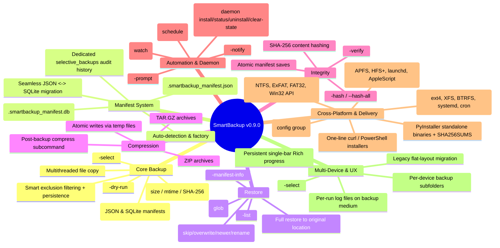

### 2.3 Directory Structure

```
smartbackup_file-backup-automation/
├── main.py                           # Quick entry point & PyInstaller target
├── pyproject.toml                    # Project metadata, deps, pytest/ruff config
├── README.md                         # User-facing documentation & quick start
├── LICENSE                           # MIT license
├── .gitattributes                    # Enforce LF endings for *.sh across OSes
├── .python-version                   # Python version (3.12 dev, 3.9+ min)
├── .gitignore
├── .github/
│   └── workflows/
│       ├── ci.yml                    # Cross-platform CI (ubuntu/macos/windows)
│       └── release.yml               # Tag-driven PyInstaller build & GitHub Release
├── scripts/
│   ├── install.sh                    # One-line macOS/Linux standalone installer
│   └── install.ps1                   # One-line Windows PowerShell standalone installer
├── src/
│   └── smartbackup/                  # Main package (src layout — 31 files, 7,227 lines)
│       ├── __init__.py               # Public API, re-exports (115 lines)
│       ├── __main__.py               # `python -m smartbackup` (8 lines)
│       ├── _version.py               # Single source of truth: __version__ = "0.9.0" (3 lines)
│       ├── backup.py                 # SmartBackup orchestrator class (175 lines)
│       ├── cli.py                    # Typer CLI & subcommands (1,301 lines)
│       ├── config.py                 # BackupConfig dataclass, ConfigManager (264 lines)
│       ├── handlers.py               # Fallback UI & OS desktop notifications (184 lines)
│       ├── models.py                 # FileInfo, FileAction, BackupResult, SelectionMetadata (87 lines)
│       ├── core/
│       │   ├── __init__.py           # Core re-exports (19 lines)
│       │   ├── engine.py             # BackupEngine, DryRunBackupEngine (689 lines)
│       │   ├── scanner.py            # FileScanner (full + scoped), ExclusionFilter (232 lines)
│       │   ├── detector.py           # ChangeDetector with scoped_folders immunity (106 lines)
│       │   ├── compressor.py         # BackupCompressor (zip/tar.gz) (188 lines)
│       │   └── restore.py            # RestoreEngine, ConflictResolution (411 lines)
│       ├── manifest/
│       │   ├── __init__.py           # Manifest re-exports (39 lines)
│       │   ├── base.py               # Manifest, ManifestEntry, ManifestDiff, SelectiveBackupRecord, ManifestManager ABC (562 lines)
│       │   ├── factory.py            # get_manifest_manager, detect_manifest_manager, has_manifest (84 lines)
│       │   ├── json_manifest.py      # JsonManifestManager (89 lines)
│       │   └── sqlite_manifest.py    # SqliteManifestManager with selective_backups table (291 lines)
│       ├── platform/
│       │   ├── __init__.py           # Platform re-exports (19 lines)
│       │   ├── resolver.py           # PathResolver (documents, Win32/macOS/Linux drives) (210 lines)
│       │   ├── devices.py            # DeviceDetector & unified writability probe (96 lines)
│       │   ├── identity.py           # get_device_name(), sanitize_device_name() (40 lines)
│       │   ├── runtime.py            # Frozen-binary detection, argv builder, UTF-8 console (43 lines)
│       │   ├── scheduler.py          # SchedulerHelper (recipes + daemon install/uninstall/status) (512 lines)
│       │   ├── terminal.py           # TerminalSpawner (wt/cmd/ps, osascript, Linux emulators) (228 lines)
│       │   └── watcher.py            # DeviceWatcher, DriveMatcher, DebounceLock (455 lines)
│       └── ui/
│           ├── __init__.py           # UI re-exports (7 lines)
│           ├── colors.py             # Rich theme, shared Console, ANSI constants (49 lines)
│           ├── logger.py             # BackupLogger (single-bar Rich progress, summary, log buffer) (289 lines)
│           └── selector.py           # FolderSelector, FolderItem, KeyAction (--select TUI) (432 lines)
├── tests/                            # 4-layer test suite (34 files, 456 tests, 8,022 lines)
│   ├── conftest.py                   # Shared fixtures & autouse config isolation (96 lines)
│   ├── unit/                         # 20 fast isolated module test files (5,068 lines)
│   ├── integration/                  # 8 cross-module & in-process CLI test files (1,842 lines)
│   ├── e2e/                          # 3 full virtualized workflow test files (596 lines)
│   └── smoke/                        # 1 black-box subprocess/binary smoke suite (419 lines)
└── docs/
    ├── CHANGELOG.md
    ├── USER_GUIDE.md
    ├── codebase-analysis.md
    └── ARCHITECTURE.md               # ← This file
```

---

## 3. Architecture: Software Architect Perspective

### 3.1 High-Level Architecture

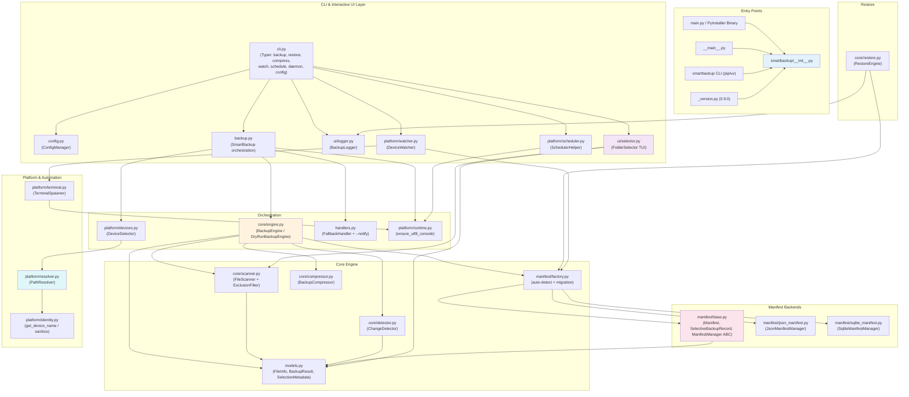

### 3.2 Package Dependency Graph

```
_version.py          → (stdlib-free leaf — single source of truth for __version__)
models.py            → (stdlib only — FileInfo, FileAction, BackupResult, SelectionMetadata)
platform/runtime.py  → (stdlib only — frozen-binary detection, argv builder, UTF-8 console)
platform/identity.py → (stdlib only — get_device_name, sanitize_device_name)
platform/resolver.py → (stdlib only — Win32 ctypes / macOS / Linux drive discovery)
platform/devices.py  → platform/resolver.py, ui/logger.py
platform/terminal.py → config.py, platform/runtime.py
platform/scheduler.py→ platform/runtime.py
platform/watcher.py  → config.py, manifest/factory.py, platform/identity.py, platform/resolver.py, platform/terminal.py
manifest/base.py     → models.py
manifest/json_manifest.py   → manifest/base.py
manifest/sqlite_manifest.py → manifest/base.py (stdlib sqlite3)
manifest/factory.py  → manifest/base.py, manifest/json_manifest.py, manifest/sqlite_manifest.py
ui/colors.py         → rich
ui/logger.py         → models.py, rich
ui/selector.py       → core/scanner.py, models.py, rich (stdlib msvcrt / termios / tty / select)
core/scanner.py      → models.py, ui/logger.py
core/detector.py     → models.py, ui/logger.py
core/compressor.py   → ui/logger.py
core/restore.py      → manifest/factory.py, models.py, ui/logger.py
core/engine.py       → config.py, core/scanner.py, core/detector.py, core/compressor.py,
                       manifest/base.py, manifest/factory.py, models.py, platform/devices.py, ui/logger.py
backup.py            → _version.py, config.py, core/engine.py, handlers.py, models.py,
                       platform/devices.py, platform/identity.py, platform/resolver.py, platform/runtime.py, ui/logger.py
cli.py               → _version.py, backup.py, config.py, core/compressor.py, core/restore.py, core/scanner.py,
                       manifest/factory.py, models.py, platform/*, ui/logger.py, ui/selector.py
```

### 3.3 Class Hierarchy

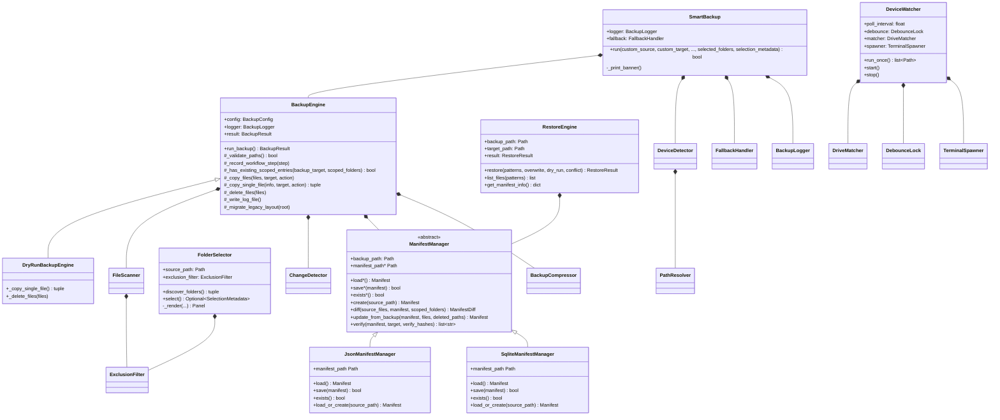

### 3.4 Architectural Decisions

| Decision | Rationale | Trade-off |
|---|---|---|
| **src-layout** (`src/smartbackup/`) | Clean separation between source and project root; prevents accidental imports | Requires `pythonpath` config in pytest |
| **Single-source `_version.py`** | Avoids drift across `__init__.py`, `cli.py`, `backup.py`, and frozen binaries | Requires parity check with `pyproject.toml` (enforced in `release.yml`) |
| **Manifest Factory & Dual Backends (JSON + SQLite)** | JSON stays human-readable for small/medium backups; SQLite scales cleanly to 100K+ files with atomic temp-DB replacement and a dedicated `selective_backups` table | Extra migration logic when switching formats |
| **Zero-dependency TUI (`ui/selector.py`)** | Keeps runtime deps strictly at `rich` + `typer` using `msvcrt` (Windows) and `termios`/`tty`/`select` (POSIX) | Requires careful terminal state cleanup (`try...finally`) and cp1252 glyph fallback |
| **Root-relative paths for `--select`** | Keeping `source_path` at the root and scoping traversal via `include_folders` guarantees seamless compatibility with full backups and `RestoreEngine` | Requires `scoped_folders` guards in `ManifestManager.diff()` and `ChangeDetector.detect_changes()` |
| **Global zero-write `--dry-run`** | Guarantees dry-run (full or selective) creates zero directories, manifests, archives, or log files on the backup medium | Preview output stays on stdout/stderr rather than persisting a log report on the drive |
| **Frozen-binary runtime helpers (`platform/runtime.py`)** | Unified `build_cli_command()` and `ensure_utf8_console()` allow identical scheduler/terminal/CLI behavior under Python and PyInstaller one-file executables | Slightly more indirection in `scheduler.py` and `terminal.py` |
| **4-layer test pyramid** | Separates fast `unit`, `integration`, `e2e`, and subprocess/binary `smoke` tests with centralized autouse config isolation | Slightly more test directory scaffolding |

---

## 4. Code Deep Dive: Developer Perspective

### 4.1 Entry Points & Frozen Runtime (`main.py`, `__main__.py`, `platform/runtime.py`)

**`main.py`** — Quick-run entry for repo checkout and PyInstaller build target:
```python
src_path = Path(__file__).parent / "src"
if src_path.exists() and str(src_path) not in sys.path:
    sys.path.insert(0, str(src_path))

from smartbackup import main as run_backup

if __name__ == "__main__":
    sys.exit(run_backup())
```

**`__main__.py`** — Enables `python -m smartbackup`:
```python
from smartbackup import main

if __name__ == "__main__":
    raise SystemExit(main())
```

**`platform/runtime.py`** — Handles frozen PyInstaller binaries vs Python interpreter invocations and Windows cp1252 UTF-8 console reconfiguration:
```python
def is_frozen_binary() -> bool:
    return bool(getattr(sys, "frozen", False))

def build_cli_command(*args: str, python_exe: Optional[str] = None) -> list[str]:
    if python_exe is None and is_frozen_binary():
        return [sys.executable, *args]
    exe = python_exe or sys.executable
    return [exe, "-m", "smartbackup", *args]

def ensure_utf8_console() -> None:
    for stream in (sys.stdout, sys.stderr):
        encoding = getattr(stream, "encoding", None)
        if encoding and encoding.lower().replace("-", "") != "utf8":
            reconfigure = getattr(stream, "reconfigure", None)
            if callable(reconfigure):
                try:
                    reconfigure(encoding="utf-8", errors="replace")
                except Exception:
                    pass
```

**`cli.py:1279-1301`** — The `main()` function calls `ensure_utf8_console()` before invoking Typer with `standalone_mode=False`:
```python
def main() -> int:
    ensure_utf8_console()
    try:
        result = app(standalone_mode=False)
        if isinstance(result, int):
            return result
        return 0
    except SystemExit as exc:
        code = exc.code
        if code is None:
            return 0
        return int(code) if isinstance(code, int) else 1
    except KeyboardInterrupt:
        return 130
    except Exception:
        return 1
```

### 4.2 CLI Layer (`cli.py` — 1,301 lines)

Uses **Typer** with two nested sub-apps (`daemon_app`, `config_app`) and 4 top-level subcommands (`restore`, `compress`, `watch`, `schedule`), alongside the default `@app.callback(invoke_without_command=True)` backup entry point:

- **`smartbackup [OPTIONS]`** (`backup_cmd`): handles `--list-drives`, `--list-devices`, `--show-manifest`, `--verify`, `--prompt` (auto-detected drive interactive confirmation), `--select` (TTY-guarded interactive folder picker), persisted + CLI `--exclude` merging, `--manifest-format` resolution (`CLI flag -> config.json -> "json"`), `--notify`, `--dry-run`, `--compress`, `--hash`/`--hash-all`.
- **`smartbackup restore`**: full or pattern-filtered restore with `--conflict [skip|overwrite|newer|rename]`, `--list`, `--manifest-info`, `--dry-run`.
- **`smartbackup compress`**: post-backup `zip` or `tar.gz` archiving with optional `--remove-source`.
- **`smartbackup watch`**: foreground USB mount monitoring loop honoring `--interval`, `--cooldown` (`flag -> config.auto_watch_cooldown -> 300`), and `--once`.
- **`smartbackup schedule`**: prints OS-specific scheduling recipes (`schtasks`, `launchd`, `cron`/`systemd`).
- **`smartbackup daemon [install|uninstall|status|clear-state]`**: manages native OS background watcher services and clears debounce state.
- **`smartbackup config [list|get|set|unset|exclude|unexclude]`**: typed CLI management for `config.json` with validation and hostname sanitization.

### 4.3 The SmartBackup Orchestrator (`backup.py` — 175 lines)

`SmartBackup.run()` resolves source/device/target, selects `DryRunBackupEngine` vs `BackupEngine`, runs the pipeline, renders the Rich summary, and triggers opt-in OS notifications:

```python
backup_mode = "select" if selected_folders is not None else "full"
config = BackupConfig(
    source_path=source_path,
    backup_path=backup_path,
    backup_folder_name="Documents-Backup",
    device_name=resolved_device_name,
    exclusions=exclusions if exclusions is not None else DEFAULT_EXCLUSIONS.copy(),
    max_workers=min(8, (os.cpu_count() or 4)),
    use_hash_verification=use_hash or hash_all,
    hash_all_files=hash_all,
    verbose=True,
    use_manifest=use_manifest,
    manifest_format=manifest_format,
    compress_format=compress_format,
    backup_mode=backup_mode,
    selected_folders=selected_folders,
    selection_metadata=selection_metadata,
)
engine_cls = DryRunBackupEngine if dry_run else BackupEngine
engine = engine_cls(config, self.logger)
result = engine.run_backup()
self.logger.summary(result)
success = result.errors == 0
self.fallback.notify_completion(result, success, desktop=notify)
return success
```

### 4.4 The Backup Pipeline (`core/engine.py` — 689 lines)

`BackupEngine.run_backup()` executes a strictly ordered pipeline supporting both full and selective modes, JSON ↔ SQLite manifest migration, and zero-write dry-runs (`DryRunBackupEngine`):

1. **Path validation (`_validate_paths`)**: verifies source exists, target exists, and delegates target writability to `DeviceDetector.validate_device()`. Validation failures increment `result.errors` so CLI exits `1`.
2. **Legacy layout migration (`_migrate_legacy_layout`)**: skipped during dry-run; atomically moves legacy flat `Documents-Backup/` files into `Documents-Backup/<device>/`.
3. **Target directory & manifest initialization**: uses `detect_manifest_manager()` + `get_manifest_manager()` to auto-detect existing JSON/SQLite manifests and transparently migrate history (including `selective_backups`) if `config.manifest_format` differs.
4. **Source scan**: calls `scanner.scan(source_path, include_folders=scoped_folders)`. When `source_files` is empty in selective mode, `_has_existing_scoped_entries()` ensures deletions inside a newly emptied selected folder are still synced!
5. **Scoped change detection**:
   - Manifest mode: `manifest_manager.diff(source_files, manifest, scoped_folders=scoped_folders)`
   - Fallback mode (`--no-manifest`): `change_detector.detect_changes(..., scoped_folders=scoped_folders)`
6. **Parallel file copy & deletion**: executes new copies, modified updates, and scoped deletions with a single persistent Rich progress bar (`logger.start_progress()` → `advance_progress()` → `stop_progress()`).
7. **Manifest update & selective audit record**: updates `entries`, appends a `SelectiveBackupRecord` (with `run_id`, counts, bytes, duration, and `workflow_steps`) when `backup_mode == "select"`, or resets `last_backup_mode = "full"` while preserving prior `selective_backups` history.
8. **Optional compression**: creates atomic `.zip` / `.tar.gz` archive (skipped during dry-run).
9. **Per-run log file (`_write_log_file`)**: skipped on dry-run (`DryRunBackupEngine` sets `log_to_file = False` and never creates target dirs) and skipped if validation failed on a missing medium. In selective mode, writes dedicated `SELECTIVE BACKUP (--select)` and `SELECTIVE WORKFLOW TRACE:` sections before `SUMMARY:`.

### 4.5 Smart Exclusion Filtering & Scoped Scanning (`core/scanner.py` — 232 lines)

`ExclusionFilter` applies a 4-tier filter (exact name lookup, file extension, glob pattern regex, and Python virtual environment structural detection). `FileScanner.scan(base_path, include_folders=None)` supports both full walks and top-level folder-scoped walks while keeping every `FileInfo.relative_path` relative to `base_path` (e.g., `Projects/app.py`):

```python
if include_folders is not None:
    for folder_name in include_folders:
        folder_path = base_path / folder_name
        if not folder_path.exists() or not folder_path.is_dir():
            self.logger.warning(f"Selected folder not found, skipping: {folder_name}")
            continue
        self._scan_recursive(folder_path, base_path, files)
else:
    self._scan_recursive(base_path, base_path, files)
```

### 4.6 Dual Manifest Backends & Scoped Diff Immunity (`manifest/`)

- **`manifest/factory.py` (84 lines)**: `get_manifest_manager(backup_path, fmt)`, `detect_manifest_manager(backup_path)`, and `has_manifest(backup_path)` decouple all callers from backend specifics.
- **`manifest/base.py` (562 lines)**: defines `ManifestFormat` (`JSON`, `SQLITE`), `ManifestEntry`, `SelectiveBackupRecord`, `Manifest`, `ManifestDiff`, and `ManifestManager(ABC)`.
  - `ManifestManager.diff(source_files, manifest, scoped_folders=None)` enforces **unselected-folder and loose-root-file immunity**:
    ```python
    parts = Path(relative_path.replace("\\", "/")).parts
    if scoped_set is not None and (len(parts) < 2 or parts[0] not in scoped_set):
        continue  # Unselected folder or loose root file -> immune from deletion
    ```
  - `Manifest.from_dict()` remains 100% backward compatible with pre-v0.9.0 JSON manifests lacking `last_backup_mode`, `last_selected_folders`, or `selective_backups`.
- **`manifest/json_manifest.py` (89 lines)**: atomic temp-file + rename persistence to `.smartbackup_manifest.json`.
- **`manifest/sqlite_manifest.py` (291 lines)**: stdlib `sqlite3` backend writing atomically to `.smartbackup_manifest.db` via a sibling temp database and `os.replace()`. Stores data across three clearly separated tables:
  - `metadata (key TEXT PRIMARY KEY, value TEXT NOT NULL)`
  - `files (relative_path TEXT PRIMARY KEY, file_hash, size, mtime, permissions, backed_up_at)`
  - `selective_backups (id INTEGER PRIMARY KEY AUTOINCREMENT, run_id, timestamp, command_option, scope, source_root, selected_folders, available_folders_count, files_scanned, files_copied, files_updated, files_deleted, files_skipped, bytes_copied, duration_seconds, workflow_steps)`
  - Checks `sqlite_master` on `load()` so pre-v0.9.0 `.smartbackup_manifest.db` files without `selective_backups` load cleanly.

### 4.7 Interactive Selective Folder Backup (`ui/selector.py` — 432 lines)

Zero-dependency keyboard-driven TUI built on `rich.live.Live` + Python stdlib:
- **Windows input (`_read_key_windows`)**: `msvcrt.getwch()` handling `\x00`/`\xe0` arrow-key prefix pairs (`H` = Up, `P` = Down), `Space`, `a`/`A`, `Enter`, `Esc`/`q`/Ctrl+C, and `k`/`j`.
- **POSIX input (`_read_key_posix`)**: `termios.tcgetattr()` + `tty.setcbreak()` wrapped in `try...finally` restoring `termios.TCSADRAIN`, with a **50ms `select.select()` timeout** after `\x1b` to disambiguate bare `Esc` (cancel) from ANSI CSI/SS3 arrow sequences (`\x1b[A`, `\x1b[B`).
- **Safety & UX**:
  - `FolderSelector.discover_folders()` uses `os.scandir()` (non-recursive), excludes loose root files, `.` hidden directories, and `ExclusionFilter` matches, and annotates previously backed-up folders with `(backed up)`.
  - Escapes all dynamic folder names with `rich.markup.escape()` and escapes checkbox brackets (`\[x]`, `\[ ]`) to prevent Rich markup injection.
  - Detects terminal encoding (`_resolve_glyphs()`) and automatically falls back to ASCII glyphs (`>`, `[x]`, `^`, `v`, `*`) on legacy `cp1252` consoles.
  - Supports viewport scrolling for large directories and inline validation when confirming with 0 folders checked.

### 4.8 Multithreaded File Copy (`core/engine.py:427-527`)

Uses `ThreadPoolExecutor(max_workers=min(8, os.cpu_count() or 4))` with a mutex (`self._lock`) protecting shared counters, `_backed_up_files`, and progress bar updates. `_copy_single_file()` handles file-vs-directory type collisions and ExFAT/FAT32 metadata fallback (`shutil.copy2` → `shutil.copy` + `os.utime`).

### 4.9 SHA-256 Tiered Hashing (`core/scanner.py:223-232`)

64KB streaming SHA-256 chunks (`--hash` hashes files ≤ 50 MB; `--hash-all` hashes all files regardless of size). `--verify` checks existence, size, and SHA-256 content hashes against the active JSON or SQLite manifest.

### 4.10 Compression (`core/compressor.py` — 188 lines)

Atomic archive creation (`zip` with `ZIP_DEFLATED`, `tar.gz` with `w:gz`) using `tempfile.mkstemp(..., dir=output_path.parent)` and atomic `temp_path.replace(output_path)`.

### 4.11 Restore Engine (`core/restore.py` — 411 lines)

Supports full or glob-pattern restore (`--pattern`), manifest inspection (`get_manifest_info()`), file listing (`list_files()`), dry-run preview, atomic single-file restore (`.tmp` + `replace()`), and all 4 `ConflictResolution` modes:
- `SKIP` (default): preserve local file
- `OVERWRITE` (`--overwrite` alias): replace local file
- `NEWER`: overwrite only when backup mtime is newer than local file
- `RENAME`: preserve both files using collision-safe `<stem>.restored-<YYYYmmdd-HHMMSS><suffix>` (with `-1`, `-2`, ... tie-breakers)

### 4.12 Cross-Platform Drive Detection & USB Auto-Detect Daemon (`platform/`)

- **`platform/resolver.py` (210 lines)**:
  - **Windows**: calls Win32 `GetLogicalDrives()` with accurate `bit = ord(letter) - ord("A"); bitmask & (1 << bit)` decoding, dynamic exclusion of `SystemDrive` and `Path.home().drive`, `GetDriveTypeW` (`2` Removable / `3` Fixed), and `GetVolumeInformationW` label lookup — with filesystem fallback if Win32 ctypes fails.
  - **macOS**: enumerates `/Volumes`, excluding `Macintosh HD`, `.timemachine`, and hidden entries.
  - **Linux**: scans `/media/<user>`, `/mnt`, and `/run/media/<user>`.
- **`platform/watcher.py` (455 lines)**:
  - `DriveMatcher`: identifies SmartBackup drives via JSON/SQLite manifests, legacy layouts, or volume label matching (resilient to locked BitLocker volumes).
  - `DebounceLock`: persists `watcher_state.json` to suppress multi-partition bursts and enforce configurable cooldown (default 300s).
  - `DeviceWatcher`: polling daemon loop dispatching newly attached backup drives to `TerminalSpawner`.
- **`platform/terminal.py` (228 lines)**: spawns native interactive terminals (`wt.exe` → `cmd.exe` → `powershell.exe` on Windows; `osascript` Terminal.app/iTerm2 → `open` on macOS; `x-terminal-emulator`/`gnome-terminal`/`kitty`/`alacritty`/`konsole`/`xfce4-terminal`/`xterm` on Linux) using `build_cli_command("--target", ..., "--prompt")`, with automatic headless/SSH detection.
- **`platform/scheduler.py` (512 lines)**: prints OS periodic backup recipes (`schedule`) and installs/uninstalls/queries OS background watcher daemons (`daemon install|uninstall|status`) for Windows Task Scheduler, macOS LaunchAgents, and Linux `systemd --user`, automatically adapting argv for frozen binaries vs Python interpreters.

### 4.13 Device Identity (`platform/identity.py` — 40 lines)

`sanitize_device_name(name)` strips domain suffixes, replaces unsafe characters with `-`, and collapses hyphens; `get_device_name()` wraps `platform.node()` through `sanitize_device_name()`, and `config set device_name` reuses the exact same sanitizer.

### 4.14 Legacy Layout Migration (`core/engine.py:356-407`)

Automatically detects legacy flat `Documents-Backup/` directories, stages items into `.migration_temp_<ts>/`, and renames into `Documents-Backup/<device_name>/` (explicitly skipped under `DryRunBackupEngine`).

### 4.15 Logging System (`ui/logger.py` — 289 lines)

`BackupLogger` maintains a single persistent Rich `Progress` bar (`start_progress()` / `advance_progress()` / `stop_progress()`) so file action logs scroll cleanly above one pinned bar without line duplication, captures plain-text events in `_log_buffer` for per-run log files, and renders a styled Rich `Table` in `summary()` including `Backup Mode` and `Selected Folders` rows when `--select` was used.

---

## 5. Feature Analysis: Product Manager Perspective

### 5.1 Feature Breakdown

| Feature Category | Feature | CLI Surface | Implementation |
|---|---|---|---|
| **Core Backup** | Incremental backup | `smartbackup` (default) | `core/engine.py` |
| | Interactive selective folders | `--select` | `ui/selector.py`, `core/scanner.py`, `manifest/base.py`, `core/detector.py` |
| | Zero-write simulation | `--dry-run` (incl. `--select --dry-run`) | `core/engine.py` (`DryRunBackupEngine`) |
| | Smart exclusions + persistence | `--exclude PATTERN`, `config exclude/unexclude` | `core/scanner.py`, `config.py`, `cli.py` |
| | Multithreaded copy | automatic (`min(8, cpu_count)`) | `core/engine.py` |
| | Per-device subfolders & migration | `--device-name`, `--list-devices` | `core/engine.py`, `platform/identity.py` |
| **Manifests** | JSON & SQLite backends | `--manifest-format [json\|sqlite]`, `--no-manifest` | `manifest/factory.py`, `json_manifest.py`, `sqlite_manifest.py` |
| | Inspection & audit history | `--show-manifest`, `--verify` | `cli.py`, `manifest/base.py` |
| | Seamless format migration | automatic on format change | `core/engine.py` |
| **Restore** | Full / pattern restore | `smartbackup restore -s ... [-p ...]` | `core/restore.py`, `cli.py` |
| | 4 conflict strategies | `--conflict [skip\|overwrite\|newer\|rename]`, `--overwrite` | `core/restore.py` |
| | Inspection & preview | `--list`, `--manifest-info`, `--dry-run` | `core/restore.py`, `cli.py` |
| **Integrity** | Tiered SHA-256 hashing | `--hash` (≤50MB), `--hash-all` | `core/scanner.py`, `manifest/base.py` |
| **Compression** | Atomic ZIP / TAR.GZ | `--compress`, `smartbackup compress` | `core/compressor.py`, `cli.py` |
| **Automation** | USB mount watcher | `smartbackup watch [--interval] [--cooldown] [--once]` | `platform/watcher.py`, `platform/terminal.py` |
| | OS background daemon | `smartbackup daemon [install\|uninstall\|status\|clear-state]` | `platform/scheduler.py`, `platform/watcher.py` |
| | Interactive drive prompt | `--prompt` | `cli.py` |
| | Schedule recipes | `smartbackup schedule [--hours N]` | `platform/scheduler.py` |
| | Desktop notifications | `--notify` | `handlers.py` |
| **Config & Ops** | Config CLI | `smartbackup config [list\|get\|set\|unset\|exclude\|unexclude]` | `config.py`, `cli.py` |
| | Standalone binaries | `install.sh`, `install.ps1`, GitHub Releases | `platform/runtime.py`, `.github/workflows/release.yml`, `scripts/` |

### 5.2 Data Model Reference

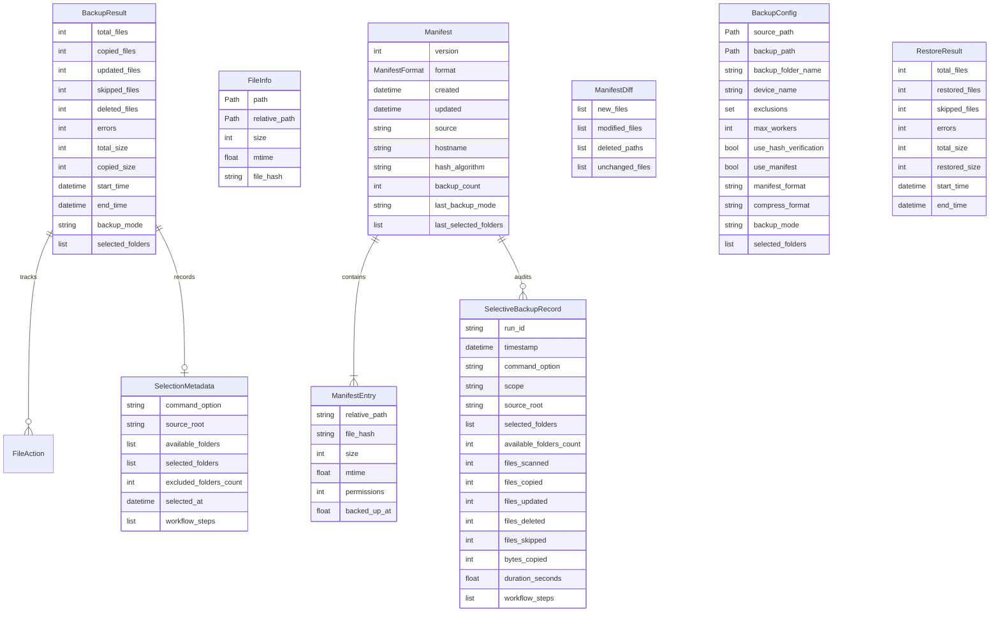

### 5.3 Target User Personas

| Persona | Use Case | Key Features Used |
|---|---|---|
| **Solo Developer** | Back up `~/Documents` or selected project folders to a USB drive | Zero-config, `--select`, auto-detection, smart filtering, standalone binary |
| **Multi-Device User** | Share one external drive across work laptop + home desktop | Per-device subfolders, `--device-name`, `--list-devices`, `daemon install` |
| **Power User with Large Repos** | Fast incremental backups of 100K+ files with integrity guarantees | `--manifest-format sqlite`, `--hash`, `--verify`, compression |
| **Non-Python / Blank-Machine User** | Install and run backups without managing Python/pip/venv | One-line `install.sh` / `install.ps1` standalone binaries |
| **Team / IT Operator** | Standardize exclusions, schedules, and notifications | `smartbackup config`, `schedule`, `--notify`, `daemon` |

### 5.4 Competitive Positioning

| Competitor | SmartBackup Advantage | SmartBackup Disadvantage |
|---|---|---|
| **rsync** | Zero-config, smart dev filtering, interactive `--select`, Rich UI, standalone binary | Local/external media only (no SSH/remote sync) |
| **rsnapshot** | Automatic filtering, Windows/macOS/Linux parity, simpler setup | No hardlink multi-version snapshot retention yet |
| **Time Machine** | Cross-platform, transparent files on drive, SQLite/JSON manifest | No GUI, no encryption yet |
| **BorgBackup** | No repo init, browseable plain-file backup tree, minimal learning curve | No block-level deduplication or encryption yet |
| **Déjà Dup** | CLI-first, scriptable, background USB auto-detect daemon | No cloud backends or encryption yet |

---

## 6. Data Flow & Core Pipelines

### 6.1 End-to-End Backup Sequence (Full & `--select`)

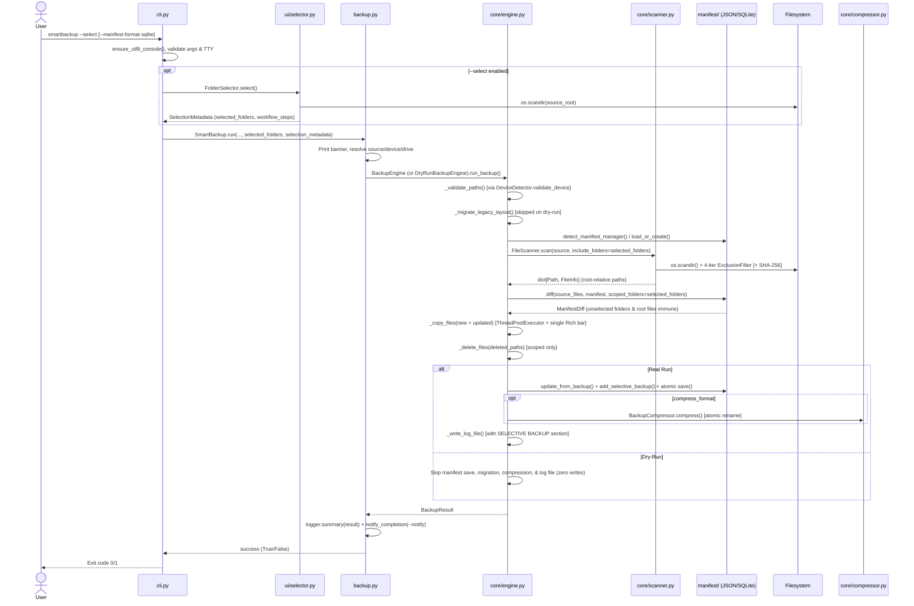

### 6.2 Change Detection & Scoped Immunity Decision Tree

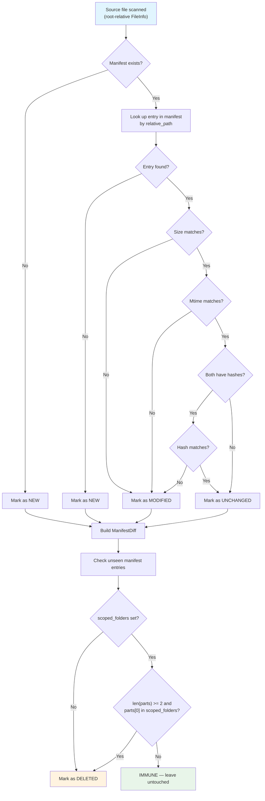

### 6.3 Backup State Machine

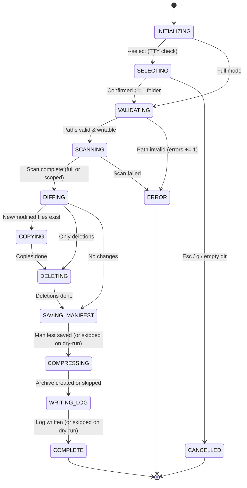

### 6.4 File Action State Flow

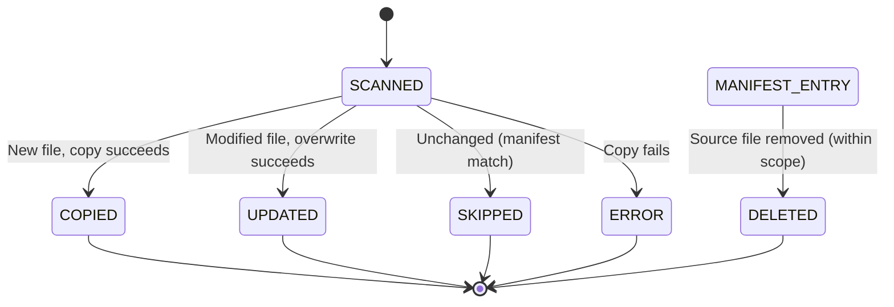

### 6.5 Legacy Layout Migration Flow

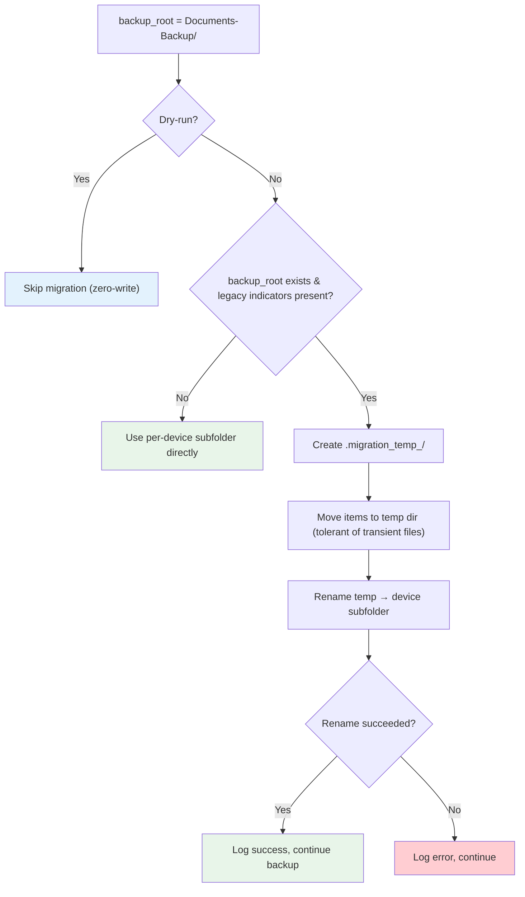

### 6.6 Exclusion Filter Decision Tree

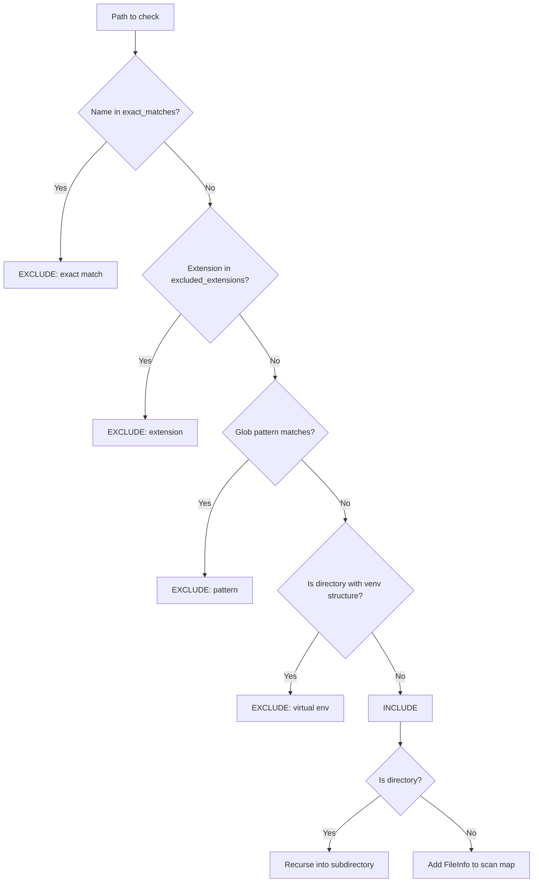

### 6.7 USB Auto-Detect & Daemon Flow

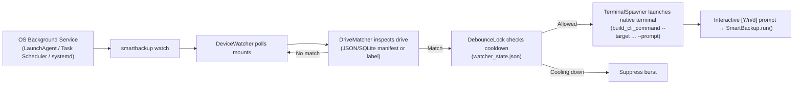

---

## 7. Component Reference

### 7.1 Top-Level Modules

| Module | Lines | Key Symbols | Purpose |
|---|---|---|---|
| `_version.py` | 3 | `__version__` (`"0.9.0"`) | Single source of truth for version |
| `__init__.py` | 115 | `__all__` (40+ symbols) | Public package API & re-exports |
| `__main__.py` | 8 | `main()` | `python -m smartbackup` entry point |
| `models.py` | 87 | `FileAction`, `FileInfo`, `SelectionMetadata`, `BackupResult` | Pure dataclasses & enums |
| `config.py` | 264 | `DEFAULT_EXCLUSIONS`, `EXCLUDED_EXTENSIONS`, `BackupConfig`, `ConfigManager` | Runtime config & persistent `config.json` |
| `handlers.py` | 184 | `FallbackHandler` (`handle_no_device`, `notify_completion`) | No-drive fallback UI & OS desktop notifications |
| `backup.py` | 175 | `SmartBackup` (`run`, `_print_banner`) | High-level backup orchestrator |
| `cli.py` | 1,301 | `app`, `daemon_app`, `config_app`, `backup_cmd`, `restore_cmd`, `compress_cmd`, `watch_cmd`, `schedule_cmd`, `main` | Full Typer CLI surface |

### 7.2 Core Engine Package (`core/`)

| Module | Lines | Key Symbols | Purpose |
|---|---|---|---|
| `core/engine.py` | 689 | `BackupEngine`, `DryRunBackupEngine` | Main backup pipeline, format migration, selective recording, zero-write dry-run |
| `core/scanner.py` | 232 | `ExclusionFilter`, `FileScanner` (`scan(..., include_folders=...)`) | 4-tier exclusions, full/scoped scan, SHA-256 hashing |
| `core/detector.py` | 106 | `ChangeDetector` (`detect_changes(..., scoped_folders=...)`) | No-manifest change detection with selective immunity |
| `core/compressor.py` | 188 | `BackupCompressor`, `SUPPORTED_FORMATS` | Atomic `zip` and `tar.gz` archive creation |
| `core/restore.py` | 411 | `ConflictResolution` (`SKIP`, `OVERWRITE`, `RENAME`, `NEWER`), `RestoreResult`, `RestoreEngine` | Multithreaded atomic restore, listing, manifest info |

### 7.3 Manifest Package (`manifest/`)

| Module | Lines | Key Symbols | Purpose |
|---|---|---|---|
| `manifest/base.py` | 562 | `ManifestFormat`, `ManifestEntry`, `SelectiveBackupRecord`, `Manifest`, `ManifestDiff`, `ManifestManager(ABC)` | Schema, scoped `diff()`, `verify()`, backward-compatible JSON serialization |
| `manifest/factory.py` | 84 | `SUPPORTED_MANIFEST_FORMATS`, `get_manifest_manager`, `detect_manifest_manager`, `has_manifest` | Backend factory & auto-detection |
| `manifest/json_manifest.py` | 89 | `JsonManifestManager` | Atomic `.smartbackup_manifest.json` persistence |
| `manifest/sqlite_manifest.py` | 291 | `SqliteManifestManager` | Atomic `.smartbackup_manifest.db` persistence (`metadata`, `files`, `selective_backups` tables) |

### 7.4 Platform Package (`platform/`)

| Module | Lines | Key Symbols | Purpose |
|---|---|---|---|
| `platform/resolver.py` | 210 | `PathResolver` | Cross-platform Documents path & external drive discovery |
| `platform/devices.py` | 96 | `DeviceDetector` (`find_backup_device`, `validate_device`) | Drive selection & unified target writability check |
| `platform/identity.py` | 40 | `get_device_name`, `sanitize_device_name` | Filesystem-safe device naming |
| `platform/runtime.py` | 43 | `is_frozen_binary`, `build_cli_command`, `ensure_utf8_console` | Frozen PyInstaller vs Python execution & UTF-8 console |
| `platform/scheduler.py` | 512 | `SchedulerHelper` | Periodic schedule recipes & OS background daemon lifecycle |
| `platform/terminal.py` | 228 | `TerminalSpawner` | Cross-platform native interactive terminal launcher |
| `platform/watcher.py` | 455 | `DriveMatcher`, `DebounceLock`, `DeviceWatcher` | USB mount polling, drive matching, cooldown debounce |

### 7.5 UI Package (`ui/`)

| Module | Lines | Key Symbols | Purpose |
|---|---|---|---|
| `ui/colors.py` | 49 | `_smartbackup_theme`, `console`, `Colors` | Rich theme, shared console, legacy ANSI constants |
| `ui/logger.py` | 289 | `BackupLogger` | Single-bar Rich progress, summary tables, log buffer |
| `ui/selector.py` | 432 | `KeyAction`, `FolderItem`, `FolderSelector`, `read_key` | Zero-dependency interactive `--select` TUI |

---

## 8. Testing & Quality

### 8.1 4-Layer Test Suite Overview (456 Tests / 34 Files / 8,022 Lines)

```
tests/
├── conftest.py                                # Shared fixtures + autouse ConfigManager isolation
├── unit/                                      # 20 files (5,068 lines) — fast isolated unit tests
│   ├── test_compressor.py                     # ZIP/TAR.GZ compression & atomic writes
│   ├── test_config.py                         # ConfigManager & BackupConfig
│   ├── test_detector.py                       # ChangeDetector & scoped immunity
│   ├── test_devices.py                        # DeviceDetector
│   ├── test_engine_unit.py                    # Engine collisions, migration, validation
│   ├── test_handlers.py                       # FallbackHandler & desktop notifications
│   ├── test_identity.py                       # Hostname sanitization
│   ├── test_logger.py                         # BackupLogger & single-bar progress
│   ├── test_manifest_json.py                  # JSON manifest, scoped diff, selective records
│   ├── test_manifest_sqlite.py                # SQLite manifest, selective_backups table, legacy DB load
│   ├── test_models.py                         # Dataclasses & SelectionMetadata
│   ├── test_package.py                        # Public exports, version parity, CLI registration
│   ├── test_resolver.py                       # PathResolver & Windows bitmask decoding
│   ├── test_restore.py                        # RestoreEngine & all 4 conflict modes
│   ├── test_runtime.py                        # Frozen binary helpers, workflows, install scripts
│   ├── test_scanner.py                        # ExclusionFilter, FileScanner, include_folders
│   ├── test_scheduler.py                      # Schedule recipes & OS daemon install/status
│   ├── test_selector.py                       # FolderSelector TUI, POSIX termios, Windows msvcrt, cp1252
│   ├── test_terminal.py                       # TerminalSpawner (Windows/macOS/Linux/headless)
│   └── test_watcher.py                        # DriveMatcher, DebounceLock, DeviceWatcher
├── integration/                               # 8 files (1,842 lines) — cross-module & CLI
│   ├── test_backup_engine.py                  # Full BackupEngine & compression integration
│   ├── test_cli_backup.py                     # Backup CLI flags, --select TTY/cancel/display
│   ├── test_cli_config.py                     # `config` subcommand roundtrips
│   ├── test_cli_daemon.py                     # `watch`, `daemon`, `schedule` CLI integration
│   ├── test_cli_restore.py                    # `restore` CLI conflicts, --list, --manifest-info
│   ├── test_dry_run_isolation.py              # Mutation gates & zero-write dry-run invariants
│   ├── test_sqlite_manifest_integration.py    # SQLite engine & JSON <-> SQLite migration
│   └── test_validation_exit.py                # Path validation exit-code contract
├── e2e/                                       # 3 files (596 lines) — full virtualized workflows
│   ├── test_autodetect_e2e.py                 # Mount detection -> debounce -> prompt -> sync
│   ├── test_exclusion_wiring_e2e.py           # CLI --exclude persistence across runs
│   └── test_select_backup_e2e.py              # Full -> selective lifecycle, SQLite/JSON/no-manifest, restore
└── smoke/                                     # 1 file (419 lines) — black-box subprocess/binary
    └── test_sandbox_smoke.py                  # Isolated subprocess & SMARTBACKUP_BINARY smoke suite
```

### 8.2 Fixture Design & Config Isolation (`conftest.py`)

`conftest.py` provides `temp_dir`, `source_dir`, `source_with_exclusions`, `backup_dir`, and `mock_external_drive`, plus an **autouse config-isolation fixture** redirecting `ConfigManager._get_config_dir()` into a temporary directory so tests never read or mutate the developer's real `~/.config/smartbackup/config.json` or `%APPDATA%\SmartBackup\config.json`.

### 8.3 Test Commands

```bash
pytest                    # Run all 456 tests across all 4 layers
pytest -m unit            # Fast isolated unit tests only
pytest -m integration     # Cross-module & in-process CLI tests
pytest -m e2e             # Full end-to-end virtualized workflows
pytest -m smoke           # Black-box subprocess smoke tests (supports SMARTBACKUP_BINARY)
pytest --cov=smartbackup  # With coverage report
ruff check src/ tests/    # Lint checks
```

### 8.4 Quality Tool & CI Configuration

From `pyproject.toml`:
```toml
[tool.pytest.ini_options]
testpaths = ["tests"]
pythonpath = ["src"]
addopts = ["-v", "--tb=short"]
markers = [
    "unit: fast isolated single-module unit tests",
    "integration: cross-module and in-process CLI integration tests",
    "e2e: full end-to-end virtualized workflow tests",
    "smoke: black-box subprocess smoke tests",
    "sandbox: black-box CLI smoke tests spawned as a subprocess in an isolated sandbox",
    "slow: marks tests as slow",
]

[tool.ruff]
target-version = "py39"
line-length = 100
src = ["src", "tests"]

[tool.ruff.lint]
select = ["E", "W", "F", "I", "B", "UP"]
ignore = ["E501"]
```

GitHub Actions (`.github/workflows/ci.yml`) runs on `ubuntu-latest`, `macos-latest`, and `windows-latest` (Python 3.12) on pushes to `main`, `feat/**`, `fix/**`, PRs to `main`, and `workflow_dispatch`:
1. `ruff check src/ tests/`
2. `PYTHONUTF8=1 pytest -v`
3. `python main.py --version` and `python main.py --help` **without `PYTHONUTF8`** (verifying Windows cp1252 UTF-8 reconfiguration).

---

## 9. Deployment & Operations

### 9.1 Installation Methods

```bash
# Method 1: One-line standalone binary (no Python required)
# macOS / Linux:
curl -fsSL https://raw.githubusercontent.com/CodingWithMK/smartbackup_file-backup-automation/main/scripts/install.sh | sh
# Windows (PowerShell):
irm https://raw.githubusercontent.com/CodingWithMK/smartbackup_file-backup-automation/main/scripts/install.ps1 | iex

# Method 2: Direct run from source (no install)
python main.py

# Method 3: pip install
pip install .
smartbackup

# Method 4: uv install (recommended for developers)
uv venv && uv pip install -e ".[dev]"
python -m smartbackup
```

### 9.2 Runtime Dependencies

| Package | Version | Purpose |
|---|---|---|
| `rich` | ≥13.0.0 | Styled terminal output, progress bars, tables, interactive `--select` Live panel |
| `typer` | ≥0.9.0 | CLI argument parsing with subcommands and auto-help |

**Optional dev dependencies:** `pytest>=7.0.0`, `pytest-cov>=4.0.0`, `ruff>=0.1.0`

### 9.3 Configuration Persistence

Config location by OS:
- **Windows**: `%APPDATA%\SmartBackup\config.json`
- **macOS/Linux**: `~/.config/smartbackup/config.json`

Persisted keys (managed via `smartbackup config`):
- `exclusions`: Custom exclusion patterns (`config exclude` / `config unexclude`)
- `preferred_target`: Preferred drive label
- `device_name`: Custom sanitized device name override
- `auto_watch_cooldown`: Watcher debounce cooldown in seconds (default `300`)
- `preferred_terminal`: Preferred terminal emulator for `watch` prompts
- `manifest_format`: Default manifest storage backend (`"json"` or `"sqlite"`, default `"json"`)

### 9.4 Backup Directory Structure

```
EXTERNAL_DRIVE/
└── Documents-Backup/
    ├── Musabs-MacBook-Pro/                       ← Per-device backup folder
    │   ├── .smartbackup_manifest.json            ← JSON manifest (OR .smartbackup_manifest.db for SQLite)
    │   ├── _backup_logs/                         ← Timestamped log files (never written on --dry-run)
    │   │   ├── backup_20261124_183000.log
    │   │   └── backup_20261124_190512.log
    │   ├── Documents/
    │   │   └── notes.txt
    │   └── Projects/
    │       └── myapp/
    │           └── main.py
    ├── Office-Desktop/                           ← Another device's backup
    │   ├── .smartbackup_manifest.db              ← SQLite manifest (files + metadata + selective_backups)
    │   └── ...
    ├── Musabs-MacBook-Pro_20261124_183000.zip    ← Compressed archive
    └── Office-Desktop_20261124_190512.tar.gz     ← Compressed archive
```

### 9.5 Log File Format (Including `--select` Audit Section)

```
======================================================================
                    BACKUP LOG - 20261124_190512
======================================================================

CONFIGURATION:
  Source:     /Users/dev/Documents
  Target:     /Volumes/BACKUP_USB/Documents-Backup/Musabs-MacBook-Pro
  Mode:       Selective (--select)
  Timestamp:  2026-11-24 19:05:12

======================================================================
                    SELECTIVE BACKUP (--select)
======================================================================
  Command Option:    --select
  Scope:             Top-level folders only
  Selected Folders:  1 of 3 available (2 hidden/excluded skipped)
    [x] Projects/
  Unselected Folders (Protected / Untouched):
    [ ] Finance/
    [ ] Photos/

  SELECTIVE WORKFLOW TRACE:
    1. CLI invoked with --select
    2. Discovered 3 selectable folder(s) (2 hidden/excluded skipped) in /Users/dev/Documents
    3. User confirmed 1 of 3 folder(s): Projects
    4. Scoped scan completed: 12 file(s) across 1 selected folder(s)
    5. Scoped diff completed: 1 new, 1 updated, 1 deleted (unselected folders untouched)

SUMMARY:
  Total Files:            12
  Copied Files:           1
  Updated Files:          1
  Deleted Files:          1
  Skipped Files:          10
  Errors:                 0
  ...
```

### 9.6 Scheduling & Background Daemon

```bash
# Print OS-specific periodic backup recipes (Task Scheduler / launchd / cron / systemd)
smartbackup schedule --hours 24

# Install, inspect, or remove the OS USB auto-detect background daemon
smartbackup daemon install
smartbackup daemon status
smartbackup daemon clear-state
smartbackup daemon uninstall
```

### 9.7 CI/CD & Standalone Binary Release Pipeline

`.github/workflows/release.yml` triggers on `v*` git tags or manual `workflow_dispatch`:
1. **`verify` job**: asserts version parity (`tag == pyproject.toml == smartbackup.__version__ == smartbackup.cli.__version__`), runs `ruff check`, and runs full `pytest -v`.
2. **`build-binaries` matrix** (`ubuntu-latest`, `macos-latest`, `windows-latest`): builds single-file executables via `PyInstaller --onefile --collect-submodules smartbackup --collect-submodules rich._unicode_data main.py`, then executes an isolated sandbox smoke test verifying `--version`, `--help` (`--dry-run`, `--select`, `--manifest-format`), backup, `--verify`, and `restore`.
3. **`publish-release` job**: generates `SHA256SUMS.txt`, stages `scripts/install.sh` and `scripts/install.ps1`, and publishes the GitHub Release via `softprops/action-gh-release@v2`.

---

## 10. Roadmap & Future Architecture

### 10.1 Release History (v0.1.0 → v0.9.0)

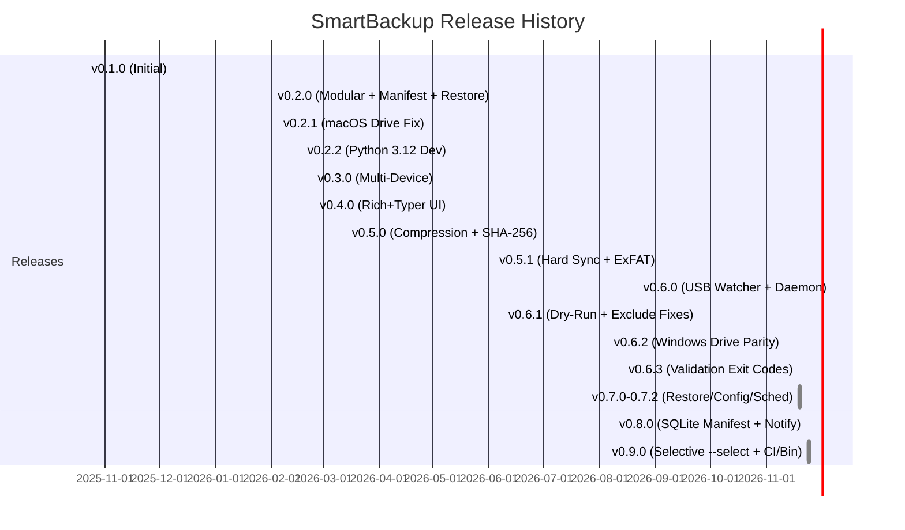

### 10.2 Planned Features

| Feature | Priority | Status | Notes |
|---|---|---|---|
| Encryption (AES-256 / age) | Medium | Planned | No crypto dependencies added yet |
| Backup profiles | Low | Planned | `ConfigManager` supports global keys; named profiles not yet modeled |
| Resume interrupted backups | Low | Planned | No mid-run checkpoint/resume yet |
| Cloud / remote targets (S3, SFTP) | Low | Planned | External/local media only today |
| Static type checking in CI (`mypy`) | Medium | Planned | Not yet added to `ci.yml` |

### 10.3 Remaining Known Issues (Synced with `codebase-analysis.md`)

| Issue | Severity | Location |
|---|---|---|
| Glob-to-regex unescaped metacharacters (`+`, `(`, `[`) | Critical | `core/scanner.py:33` |
| Silent hash failure (`""`) on unreadable files | Critical | `core/scanner.py:223-232`, `manifest/base.py:84-97` |
| Large orchestrator methods (`run_backup()` ~264 lines, `cli.py` 1,301 lines) | High | `core/engine.py:61-325`, `cli.py` |
| Multi-console fragmentation (8 separate `Console()` instances) | High | `colors.py`, `logger.py`, `selector.py`, `cli.py`, `handlers.py`, `backup.py`, `restore.py`, `scheduler.py` |
| Orphaned temp dir on failed legacy migration rename | High | `core/engine.py:356-407` |
| `ConfigManager.load()` silently returns `{}` on corrupt JSON | Medium | `config.py:166-174` |
| Logger bypass (`print(..., file=sys.stderr)`) in manifest managers | Medium | `json_manifest.py:50,88`, `sqlite_manifest.py:176,290` |
| Duplicated device-target resolution between CLI and restore | Medium | `cli.py`, `core/restore.py` |

---

## Appendix A: Quick Reference

### A.1 All Backup CLI Flags

| Flag | Description | Default |
|---|---|---|
| `-s, --source PATH` | Source directory | Documents folder |
| `-t, --target PATH` | Target drive/directory | Auto-detect |
| `-l, --label NAME` | Preferred target drive label | — |
| `--prompt` | Interactive prompt mode for detected drive (`[Y/n/d]`) | False |
| `--select` | Interactively choose top-level folders to back up (TTY required) | False |
| `--dry-run` | Simulate backup with zero target writes (no files, manifest, or logs) | False |
| `-q, --quiet` | Minimal output | False |
| `--exclude PATTERN` | Additional exclusion patterns (persisted & applied immediately) | — |
| `--list-drives` | Show available external drives and exit | False |
| `--device-name NAME` | Custom device name for backup subfolder | Hostname |
| `--list-devices` | List devices with backups on the target drive and exit | False |
| `--no-manifest` | Disable manifest tracking | False |
| `--manifest-format FMT` | Manifest backend: `json` or `sqlite` | Config or `json` |
| `--show-manifest` | Display manifest metadata & selective backup history and exit | False |
| `--verify` | Verify backup integrity against manifest and exit | False |
| `--notify` | Send OS desktop notification on completion | False |
| `--compress FORMAT` | Compress backup into `zip` or `tar.gz` archive | — |
| `--hash` | SHA-256 hashing for files ≤ 50 MB | False |
| `--hash-all` | SHA-256 hashing for all files regardless of size | False |
| `-v, --version` | Show version (`smartbackup 0.9.0`) and exit | False |

### A.2 Subcommands

```
smartbackup restore       Restore files from backup
  -s, --source PATH       Backup source directory (required)
  -t, --target PATH       Restore destination (default: original location)
  -p, --pattern TEXT      Glob patterns to filter files
  --conflict STRATEGY     skip | overwrite | newer | rename (default: skip)
  --overwrite             Alias for --conflict overwrite
  --dry-run               Preview without restoring
  --list                  List files in backup (honors --pattern)
  --manifest-info         Display manifest metadata summary and exit
  --device-name TEXT      Device subfolder name

smartbackup compress      Compress an existing backup into an archive
  -t, --target PATH       Backup drive directory (required)
  -f, --format TEXT       "zip" or "tar.gz" (default: zip)
  --device-name TEXT      Device subfolder name
  --remove-source         Remove uncompressed folder after compression

smartbackup watch         Watch for external backup storage media and trigger prompts
  --interval FLOAT        Polling interval in seconds (default: 3.0)
  --cooldown INT          Debounce cooldown in seconds (flag -> config -> 300)
  --once                  Run a single scan pass and exit

smartbackup schedule      Show OS-specific instructions to schedule periodic backups
  --hours INT             Backup interval in hours (default: 24)

smartbackup daemon        Manage OS background watcher daemon service
  install                 Install and start background watcher service
  uninstall               Uninstall and stop background watcher service
  status                  Check service status, PID, and service file location
  clear-state             Clear watcher debounce state (watcher_state.json)

smartbackup config        Inspect and update persistent SmartBackup configuration
  list                    Show all config keys and effective values
  get KEY                 Get a single configuration key
  set KEY VALUE           Set and validate a configuration key
  unset KEY               Remove a configuration key to restore default
  exclude PATTERN...      Add one or more custom exclusion patterns
  unexclude PATTERN...    Remove one or more custom exclusion patterns
```

### A.3 Key File Paths

| Item | Path |
|---|---|
| JSON manifest | `Documents-Backup/<device>/.smartbackup_manifest.json` |
| SQLite manifest | `Documents-Backup/<device>/.smartbackup_manifest.db` |
| Log files | `Documents-Backup/<device>/_backup_logs/backup_<timestamp>.log` |
| Config file (Windows) | `%APPDATA%\SmartBackup\config.json` |
| Config file (macOS/Linux) | `~/.config/smartbackup/config.json` |
| Watcher debounce state | `<config_dir>/watcher_state.json` |

---

## Appendix B: Troubleshooting

### B.1 Common Issues

| Symptom | Likely Cause | Fix |
|---|---|---|
| "No external medium found" | Drive not connected or not detected | Check connection, try `--list-drives` |
| `--select` exits with code 1 | Invoked in non-TTY / piped / CI environment | Run in an interactive terminal or omit `--select` |
| Backup is slow on 100K+ files | Large JSON manifest serialization | Switch to SQLite via `--manifest-format sqlite` or `config set manifest_format sqlite` |
| Files not excluded on Linux | Case-sensitive filesystem or regex metacharacters | Check `config list` and verify exclusion pattern |
| "OS error 22" | FAT32/ExFAT metadata limitations | Handled via automatic fallback (`shutil.copy` + `os.utime`), or format drive as NTFS/APFS/ext4 |
| Manifest corrupted | Power loss during backup | Delete `.smartbackup_manifest.json` or `.smartbackup_manifest.db` (rebuilt on next run) |
| Watcher doesn't re-prompt | Debounce cooldown active | Run `smartbackup daemon clear-state` or lower `auto_watch_cooldown` |

### B.2 Debug Mode

```bash
# Preview what a backup (full or selective) would do with zero writes
smartbackup --dry-run --source ~/Projects
smartbackup --select --dry-run

# Verify backup integrity against manifest
smartbackup --target /media/USB --verify

# Inspect manifest metadata & selective backup history
smartbackup --target /media/USB --show-manifest
smartbackup restore --source /media/USB --manifest-info
smartbackup restore --source /media/USB --list
```

---

*Document updated on 2026-11-25. Based on commit history from v0.1.0 (2025-10-21) through v0.9.0 (2026-11-25).*
