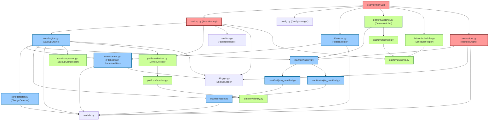
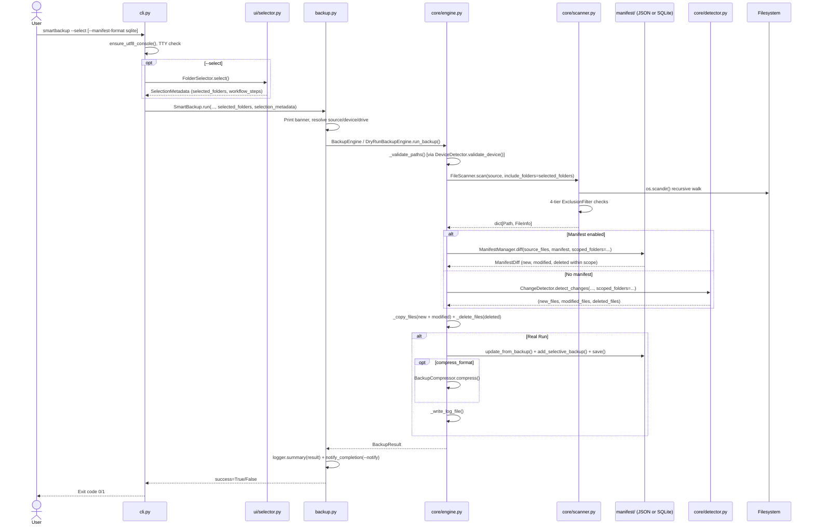
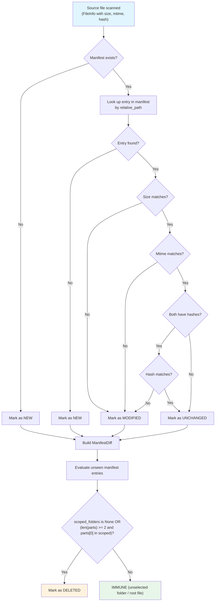
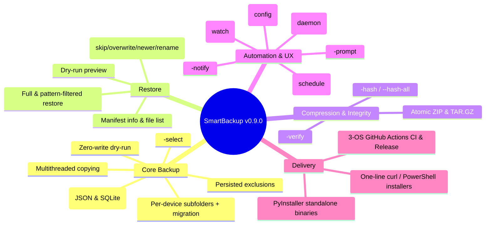
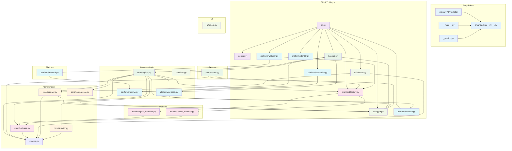
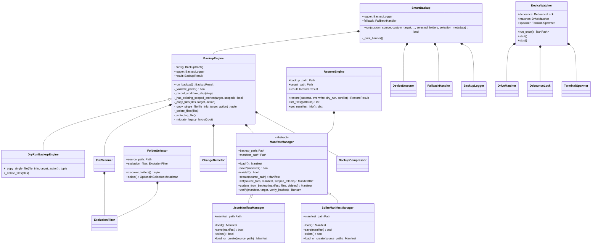
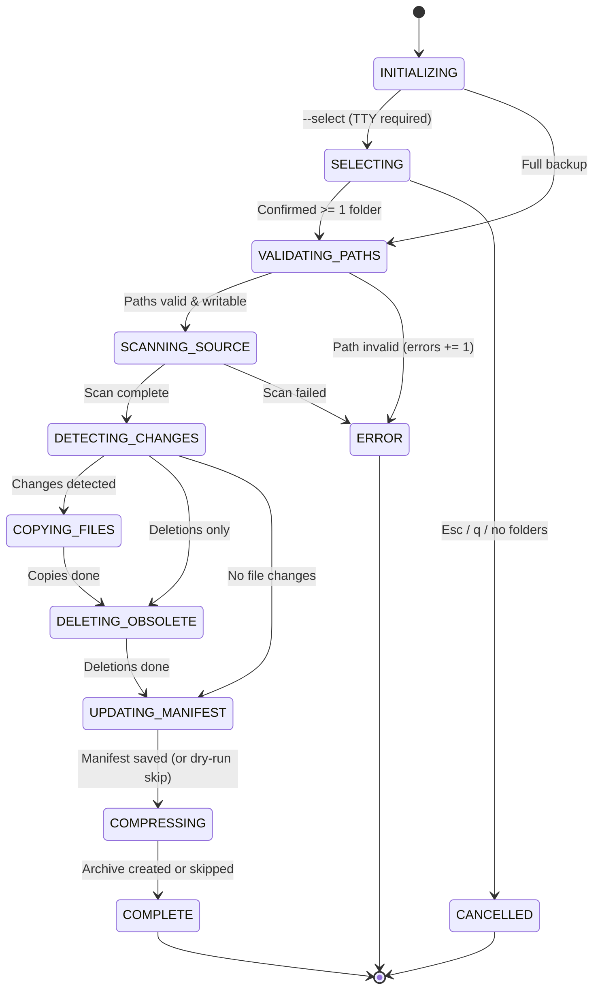
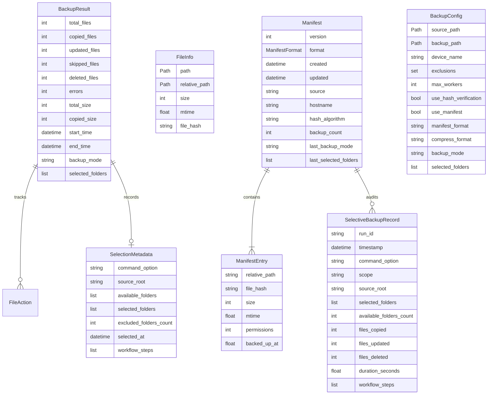
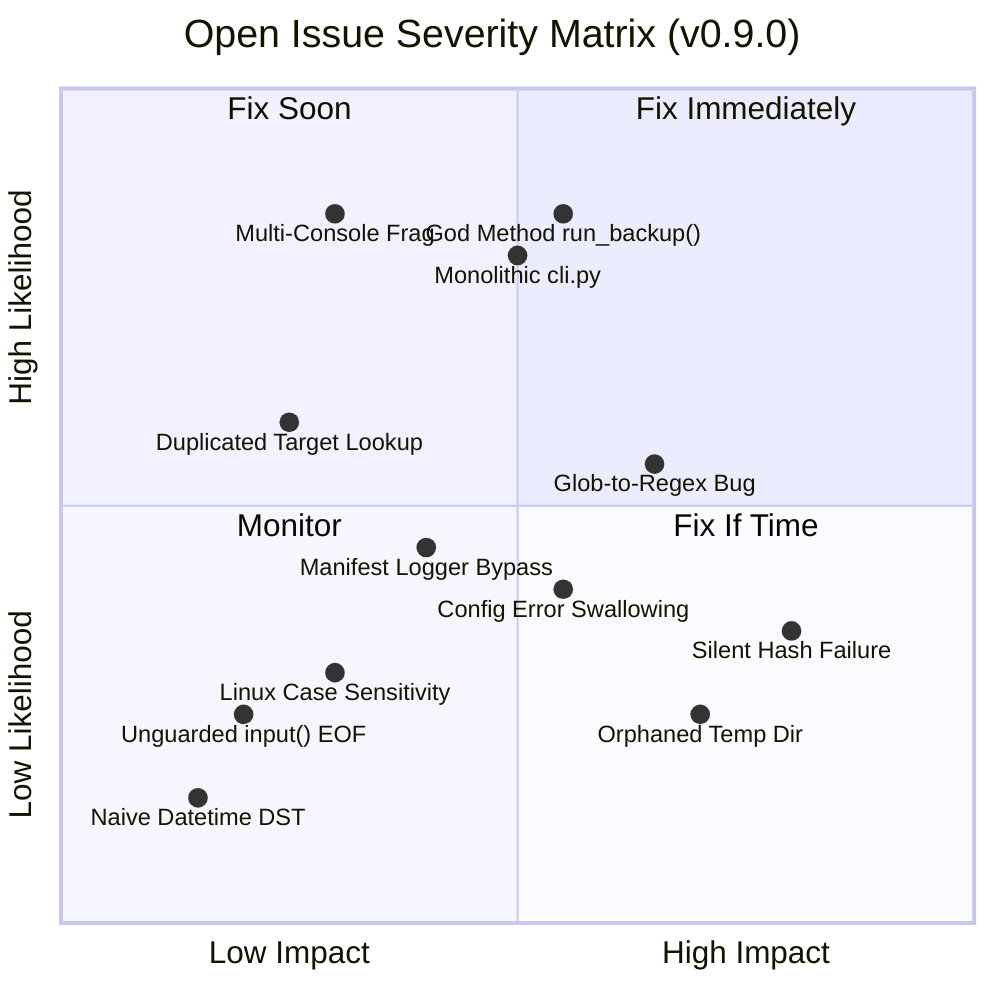

# SmartBackup Codebase Analysis

> **Version**: 0.9.0  
> **Author**: Muhammed Musab Kaya (@CodingWithMK)  
> **Repository**: [smartbackup_file-backup-automation](https://github.com/CodingWithMK/smartbackup_file-backup-automation)  
> **Language**: Python 3.9+  
> **License**: MIT

---

## Table of Contents

1. [Executive Summary](#1-executive-summary)
2. [Software Architecture Perspective](#2-software-architecture-perspective)
3. [Software Developer Perspective](#3-software-developer-perspective)
4. [Product Manager Perspective](#4-product-manager-perspective)
5. [Critical Findings & Recommendations](#5-critical-findings--recommendations)
6. [Appendix: Architecture Diagrams](#6-appendix-architecture-diagrams)

---

## 1. Executive Summary

SmartBackup is a cross-platform incremental backup tool for developers that automatically filters out build artifacts (`node_modules`, `venv`, `__pycache__`, `.git`, etc.). It is written in Python 3.9+ with a modular src-layout structure (**31 Python modules / 7,227 source lines**), **456 automated tests** across a 4-layer test suite (`unit`, `integration`, `e2e`, `smoke` — 34 files / 8,022 lines), cross-platform CI/CD (`ubuntu-latest`, `macos-latest`, `windows-latest`) with PyInstaller standalone releases, and depends only on `rich` and `typer` at runtime.

**Health Assessment (v0.9.0)**: The codebase has matured substantially since v0.5.1 — fixing the critical Windows drive-detection bitmask bug, eliminating dry-run state mutation, unifying target writability checks, completing all 4 restore conflict strategies, adding dual JSON/SQLite manifests, USB auto-detect daemons, interactive `--select` folder backups, and cross-platform CI. However, **2 critical bugs**, **7 major maintainability issues**, and **5 minor issues** remain open and should be resolved before a v1.0 release — most notably the unescaped glob-to-regex conversion in `ExclusionFilter`, silent empty-string hash failures on unreadable files, and growing complexity in `BackupEngine.run_backup()` (264 lines) and `cli.py` (1,301 lines).

---

## 2. Software Architecture Perspective

### 2.1 High-Level Architecture

```
src/smartbackup/                    # 31 files, 7,227 lines
├── __init__.py                     # Package exports & public API (115)
├── __main__.py                     # `python -m smartbackup` entry point (8)
├── _version.py                     # Single source of truth: __version__ = "0.9.0" (3)
├── backup.py                       # SmartBackup orchestration class (175)
├── cli.py                          # Typer CLI: backup, restore, compress, watch, schedule, daemon, config (1,301)
├── config.py                       # BackupConfig dataclass, ConfigManager (264)
├── handlers.py                     # Fallback UI & cross-platform desktop notifications (184)
├── models.py                       # FileInfo, FileAction, BackupResult, SelectionMetadata (87)
├── core/                           # Core backup & restore logic
│   ├── __init__.py                 # Package exports (19)
│   ├── engine.py                   # BackupEngine, DryRunBackupEngine (689)
│   ├── scanner.py                  # FileScanner (full + include_folders), ExclusionFilter (232)
│   ├── detector.py                 # ChangeDetector with scoped_folders immunity (106)
│   ├── compressor.py               # BackupCompressor (zip/tar.gz) (188)
│   └── restore.py                  # RestoreEngine, ConflictResolution (411)
├── manifest/                       # Dual-backend manifest tracking system
│   ├── __init__.py                 # Package exports (39)
│   ├── base.py                     # Manifest, ManifestEntry, ManifestDiff, SelectiveBackupRecord, ManifestManager ABC (562)
│   ├── factory.py                  # get_manifest_manager, detect_manifest_manager, has_manifest (84)
│   ├── json_manifest.py            # JsonManifestManager (89)
│   └── sqlite_manifest.py          # SqliteManifestManager with selective_backups table (291)
├── platform/                       # Cross-platform abstractions & daemon automation
│   ├── __init__.py                 # Package exports (19)
│   ├── resolver.py                 # PathResolver (documents, Win32/macOS/Linux external drives) (210)
│   ├── devices.py                  # DeviceDetector & unified writability probe (96)
│   ├── identity.py                 # get_device_name(), sanitize_device_name() (40)
│   ├── runtime.py                  # Frozen-binary detection, argv builder, UTF-8 console (43)
│   ├── scheduler.py                # SchedulerHelper (recipes + OS daemon lifecycle) (512)
│   ├── terminal.py                 # TerminalSpawner (wt/cmd/ps, osascript, Linux emulators) (228)
│   └── watcher.py                  # DeviceWatcher, DriveMatcher, DebounceLock (455)
└── ui/                             # User interface
    ├── __init__.py                 # Package exports (7)
    ├── colors.py                   # Rich theme, shared Console, ANSI constants (49)
    ├── logger.py                   # BackupLogger (single-bar Rich progress + log buffer) (289)
    └── selector.py                 # FolderSelector, FolderItem, KeyAction (--select TUI) (432)
```

### 2.2 Dependency Flow



### 2.3 Architectural Strengths

| Strength | Description | Evidence |
|---|---|---|
| **Clean package separation** | Modular layout (`core/`, `manifest/`, `platform/`, `ui/`) with pure leaf modules (`_version.py`, `models.py`, `runtime.py`, `identity.py`, `resolver.py`) | Clear acyclic layering |
| **Dual manifest backends via Factory + ABC** | `ManifestManager(ABC)` implemented cleanly by both `JsonManifestManager` and `SqliteManifestManager` with auto-detection and live format migration | `manifest/factory.py`, `manifest/sqlite_manifest.py` |
| **Zero-dependency cross-platform TUI** | `--select` interactive folder picker uses only `rich` + stdlib (`msvcrt` / `termios` / `tty` / `select`) with `try...finally` restoration and `cp1252` fallback | `ui/selector.py` |
| **Unselected-folder immunity & root-relative layout** | Scoped backups keep `source_path` at root and enforce `len(parts) < 2 or parts[0] not in scoped_set` across manifests and `ChangeDetector` | `manifest/base.py`, `core/detector.py`, `core/scanner.py` |
| **Global zero-write dry-run** | `DryRunBackupEngine` gates copies, deletions, manifest writes, layout migrations, compression, and log files | `core/engine.py`, `tests/integration/test_dry_run_isolation.py` |
| **Frozen-binary & UTF-8 runtime support** | Single-source `_version.py` + `platform/runtime.py` make scheduler/terminal/CLI work identically under Python and PyInstaller binaries | `platform/runtime.py`, `.github/workflows/release.yml` |
| **Atomic write patterns** | JSON manifests, SQLite databases, archives, and restored files all write to temp files and atomically swap via `replace()` | `json_manifest.py`, `sqlite_manifest.py`, `compressor.py`, `restore.py` |
| **4-layer test pyramid + 3-OS CI** | 456 tests across `unit/`, `integration/`, `e2e/`, `smoke/` with centralized autouse config isolation and live GitHub Actions verification | `tests/`, `.github/workflows/ci.yml` |

### 2.4 Architectural Weaknesses

| Weakness | Severity | Location |
|---|---|---|
| **God method in `run_backup()`** — now ~264 lines handling validation, migration, format switching, scanning, diffing, copying, deleting, selective audit, compression, and logging | **High** | `core/engine.py:61-325` |
| **Monolithic `cli.py`** — grew from 649 to 1,301 lines across 7 command groups/subcommands | **High** | `cli.py:1-1301` |
| **Multi-console fragmentation** — 8 files instantiate separate `Console()` objects; only `ui/colors.py` uses `_smartbackup_theme` | **High** | `colors.py`, `logger.py`, `selector.py`, `cli.py`, `handlers.py`, `backup.py`, `restore.py`, `scheduler.py` |
| **Duplicated device-target resolution logic** | **Medium** | `cli.py` and `core/restore.py` |
| **Logger bypass in manifest layer** — both JSON and SQLite managers print warnings directly to `sys.stderr` | **Medium** | `json_manifest.py:50,88`, `sqlite_manifest.py:176,290` |
| **Silent config load error swallowing** — `ConfigManager.load()` returns `{}` on all exceptions | **Medium** | `config.py:166-174` |

---

## 3. Software Developer Perspective

### 3.1 Data Flow: End-to-End Backup (Full & `--select`)



### 3.2 Change Detection & Scoped Immunity Strategies



### 3.3 Key Code Snippets to Understand

#### Scoped Manifest Diff (`manifest/base.py`)

Protects unselected folders and loose root files (including a root file that happens to share a selected folder's name):

```python
scoped_set = set(scoped_folders) if scoped_folders is not None else None
for relative_path in manifest.entries:
    if relative_path not in seen_paths:
        if scoped_set is not None:
            parts = Path(relative_path.replace("\\", "/")).parts
            if len(parts) < 2 or parts[0] not in scoped_set:
                continue
        result.deleted_paths.append(relative_path)
```

#### Dual Manifest Factory & Auto-Detection (`manifest/factory.py`)

```python
def detect_manifest_manager(backup_path: Path) -> Optional[ManifestManager]:
    sqlite_mgr = SqliteManifestManager(backup_path)
    if sqlite_mgr.exists():
        return sqlite_mgr
    json_mgr = JsonManifestManager(backup_path)
    if json_mgr.exists():
        return json_mgr
    return None
```

#### Atomic SQLite Save with Dedicated `selective_backups` Table (`manifest/sqlite_manifest.py`)

Writes `metadata`, `files`, and `selective_backups` into a sibling temp database and atomically replaces `.smartbackup_manifest.db` via `os.replace()`. On `load()`, checks `sqlite_master` for `selective_backups` so legacy pre-v0.9.0 databases load cleanly.

#### Zero-Dependency POSIX Escape Disambiguation (`ui/selector.py:68-123`)

```python
old_settings = termios.tcgetattr(fd)
try:
    tty.setcbreak(fd)
    ...
    if ch == "\x1b":
        ready, _, _ = select.select([fd], [], [], 0.05)
        if not ready:
            return KeyAction.CANCEL  # Bare Esc
        # Otherwise decode CSI/SS3 arrow sequence (\x1b[A / \x1b[B)
finally:
    termios.tcsetattr(fd, termios.TCSADRAIN, old_settings)
```

### 3.4 Testing Strategy

The test suite has grown from **194 tests (16 flat files)** in v0.5.1 to **456 passing tests (34 files, 8,022 lines)** structured into 4 registered pytest layers:

```
tests/
├── conftest.py          # Shared fixtures + autouse ConfigManager isolation (96 lines)
├── unit/                # 20 files, 5,068 lines (scanner, detector, selector, JSON/SQLite manifest, runtime, watcher, terminal, scheduler, resolver, restore, etc.)
├── integration/         # 8 files, 1,842 lines (engine, CLI backup/config/daemon/restore, dry-run isolation, SQLite migration, validation exit codes)
├── e2e/                 # 3 files, 596 lines (autodetect E2E, exclusion wiring E2E, selective backup E2E)
└── smoke/               # 1 file, 419 lines (isolated subprocess & SMARTBACKUP_BINARY smoke tests)
```

**Testing strengths (major improvements since v0.5.1)**:
- Windows Win32 drive-detection bitmask decoding & volume-label resolution are now covered by unit tests (`tests/unit/test_resolver.py`, `tests/unit/test_watcher.py`).
- Cross-platform TUI (`termios` restoration, 50ms ESC disambiguation, Windows `msvcrt`, `cp1252` ASCII fallback, Rich markup injection) is deterministically unit-tested (`tests/unit/test_selector.py`).
- Frozen-binary runtime helpers, CI/release workflow contracts, and `install.sh` / `install.ps1` syntax are tested (`tests/unit/test_runtime.py`).
- Centralized autouse config isolation prevents tests from polluting developer configs.
- Live GitHub Actions runs the full 456-test suite across `ubuntu-latest`, `macos-latest`, and `windows-latest`.

**Remaining testing gaps**:
- `DeviceDetector` coverage (`tests/unit/test_devices.py`, 33 lines) is still minimal compared to other platform modules.
- No property-based / fuzz testing (e.g., `hypothesis`) for `ExclusionFilter` glob patterns or path edge cases.
- No static type-checking step (`mypy` / `pyright`) in CI yet.

---

## 4. Product Manager Perspective

### 4.1 Feature Map



### 4.2 Target User Personas

| Persona | Use Case | Key Features |
|---|---|---|
| **Solo Developer** | Back up `~/Documents` or pick specific project folders quickly | Zero-config, `--select`, smart filtering, standalone binary |
| **Multi-Device User** | Share one external drive across laptop + desktop with auto-prompt | Per-device subfolders, `--device-name`, `daemon install` |
| **Power User / Large Codebases** | Fast incremental scans over 100K+ files with integrity verification | `--manifest-format sqlite`, `--hash`, `--verify`, compression |
| **Non-Python End User** | Install and run backups on a blank machine without Python | `install.sh` / `install.ps1` standalone binaries |
| **Team / IT Operator** | Standardize exclusions, schedules, and notifications | `config` command group, `schedule`, `--notify` |

### 4.3 Competitive Positioning

| Competitor | SmartBackup Advantage | SmartBackup Disadvantage |
|---|---|---|
| **rsync** | Zero-config, smart dev filtering, `--select` TUI, Rich UI, standalone binary | No SSH / remote sync |
| **rsnapshot** | Automatic filtering, native Windows support, simpler setup | No hardlink retention snapshots |
| **Time Machine** | Cross-platform, inspectable backup layout, SQLite/JSON manifests | No GUI, no encryption yet |
| **BorgBackup** | No repo init, plain-file browsable backups, minimal learning curve | No deduplication or encryption yet |
| **Déjà Dup** | CLI-first, scriptable, USB auto-detect daemon | No cloud backends or encryption yet |

### 4.4 Roadmap Alignment

| Planned Feature | Current Status | Code Evidence |
|---|---|---|
| **SQLite manifest backend** | ✅ **Delivered (v0.8.0)** + `selective_backups` table (v0.9.0) | `manifest/sqlite_manifest.py`, `manifest/factory.py` |
| **Desktop notifications (`--notify`)** | ✅ **Delivered (v0.8.0)** | `handlers.py:97-184` (`osascript`, `notify-send`, PowerShell) |
| **USB watcher, terminal spawner & OS daemon** | ✅ **Delivered (v0.6.0 / v0.7.2)** | `platform/watcher.py`, `platform/terminal.py`, `platform/scheduler.py` |
| **Interactive selective folder backup (`--select`)** | ✅ **Delivered (v0.9.0)** | `ui/selector.py`, `core/scanner.py`, `manifest/base.py` |
| **Standalone binaries & cross-platform CI** | ✅ **Delivered (v0.9.0)** | `platform/runtime.py`, `.github/workflows/`, `scripts/` |
| **Encryption (AES-256 / age)** | ⏳ Not started | No crypto imports anywhere in codebase |
| **Backup profiles** | ⏳ Not started | `ConfigManager` stores flat global keys |
| **Resume interrupted backups** | ⏳ Not started | No mid-run checkpoint/resume mechanism |

---

## 5. Critical Findings & Recommendations

### 5.0 Resolved Since v0.5.1

| Former ID | Finding | Resolution |
|---|---|---|
| **CRIT-1** | Windows drive detection bitmask offset bug (`resolver.py`) | ✅ Fixed in v0.6.2 (`bit = ord(letter) - ord("A"); bitmask & (1 << bit)` + dynamic system-drive exclusion + tests) |
| **MAJ-4** | Duplicate write-test logic & dead `DeviceDetector.validate_device()` | ✅ Fixed in v0.7.2 (`BackupEngine._validate_paths()` delegates to `DeviceDetector.validate_device()`) |
| **Minor** | Unused `ConflictResolution.RENAME` & unreachable `NEWER` | ✅ Fixed in v0.7.0 (`restore --conflict [skip\|overwrite\|newer\|rename]`) |
| **Minor** | Dead `Align` import in `backup.py` | ✅ Fixed (`Align.center(art)` used in `_print_banner()`) |
| **Minor** | Hardcoded `.smartbackup_manifest.json` in `cli.py` | ✅ Fixed in v0.8.0 via `manifest/factory.py` |
| **Wiring** | `--dry-run` mutated manifest & `--exclude` patterns weren't merged | ✅ Fixed in v0.6.1 & hardened to global zero-write `--dry-run` in v0.9.0 |
| **Wiring** | Failed path validation exited `0` | ✅ Fixed in v0.6.3 (`errors += 1` → exit `1`) |

### 5.1 🔴 Open Critical Bugs

#### CRIT-1: Glob-to-Regex Conversion Breaks on Special Regex Characters

**Location**: `src/smartbackup/core/scanner.py:33`

```python
regex = excl.replace(".", r"\.").replace("*", ".*").replace("?", ".")
self.patterns.append(re.compile(f"^{regex}$", re.IGNORECASE))
```

**Problem**: Regex metacharacters such as `+`, `(`, `)`, `[`, `]`, `{`, `}`, `^`, `$`, `|`, and `\` are not escaped. Adding an exclusion like `--exclude "backup+(1)*"` can raise `re.error` or silently mis-match paths.

**Fix**: Replace manual string substitution with `fnmatch.translate(excl)` from Python's standard library.

#### CRIT-2: Silent Hash Failure Masks Data Corruption

**Locations**:
- `src/smartbackup/core/scanner.py:223-232`
- `src/smartbackup/manifest/base.py:84-97`

```python
def _calculate_hash(self, path: Path, chunk_size: int = 65536) -> str:
    hasher = hashlib.sha256()
    try:
        ...
        return hasher.hexdigest()
    except Exception:
        return ""  # Silent failure: unreadable/corrupt file drops hash comparison
```

**Problem**: When a file cannot be read during hashing, `_calculate_hash()` silently returns `""`. Downstream, `has_changed()` checks `if file_info.file_hash and self.file_hash:` and falls back to skipping hash verification without logging a warning or counting an error.

**Fix**: Return `Optional[str]` (`None` on failure), log a warning through `self.logger`, and surface unreadable-file errors explicitly during `--hash` / `--verify`.

### 5.2 🟠 Open Major Issues

#### MAJ-1: `BackupEngine.run_backup()` Violates Single Responsibility Principle

**Location**: `src/smartbackup/core/engine.py:61-325`

Now **~264 lines** orchestrating validation, legacy migration, manifest detection and JSON ↔ SQLite format migration, full/scoped scanning, diffing, parallel copy/delete, selective history recording, compression, and log writing. Decompose into focused private helpers (`_initialize_manifest()`, `_compute_changes()`, `_finalize_manifest()`, `_maybe_compress()`).

#### MAJ-2: Monolithic `cli.py`

**Location**: `src/smartbackup/cli.py:1-1301`

At **1,301 lines**, `cli.py` combines the default backup callback, restore/compress/watch/schedule commands, `daemon` and `config` sub-apps, manifest rendering tables, and interactive `--prompt` / `--select` orchestration. Splitting into a `cli/` subpackage (`cli/app.py`, `cli/backup.py`, `cli/restore.py`, `cli/daemon.py`, `cli/config.py`) will significantly improve readability and maintainability.

#### MAJ-3: Multi-Console Fragmentation

Eight files construct separate `Console()` instances, while only `ui/colors.py` attaches `_smartbackup_theme`:

| File | Line(s) | Uses Shared Theme? |
|---|---|---|
| `ui/colors.py` | 25 | **Yes** |
| `ui/logger.py` | 48 | No |
| `ui/selector.py` | 211 | No |
| `cli.py` | 39 | No |
| `handlers.py` | 18 | No |
| `backup.py` | 166 | No |
| `core/restore.py` | 349 | No |
| `platform/scheduler.py` | 42, 77, 117 | No |

**Fix**: Standardize on the shared `console` from `ui/colors.py` (with optional DI override for tests).

#### MAJ-4: Migration Failure Can Leave Orphaned Temp Directory

**Location**: `src/smartbackup/core/engine.py:356-407`

If the final rename fails during legacy layout migration, `.migration_temp_*` can remain behind with no automated rollback.

#### MAJ-5: `ConfigManager.load()` Silently Returns `{}` on All Errors

**Location**: `src/smartbackup/config.py:166-174`

A corrupt `config.json` or permission error silently resets loaded preferences to `{}` without warning the user; differentiate `FileNotFoundError` from `json.JSONDecodeError` / `OSError`.

#### MAJ-6: Manifest Managers Bypass `BackupLogger`

**Locations**: `manifest/json_manifest.py:50,88`, `manifest/sqlite_manifest.py:176,290`

Both backends still write warnings directly via `print(..., file=sys.stderr)`, bypassing `--quiet` mode and per-run log capture.

#### MAJ-7: Duplicated Device-Target Resolution & Case-Insensitive Linux Exclusions

- **Duplicated target resolution**: `cli.py` and `core/restore.py` duplicate `Documents-Backup/<device>` target lookup; extract a shared helper in `platform/resolver.py`.
- **Case-insensitivity (`core/scanner.py:45`)**: `ExclusionFilter` lowercases path names unconditionally across all OSes, which should be documented or made platform-aware on case-sensitive Linux filesystems.

### 5.3 🟡 Open Minor Issues

| Issue | Location | Description |
|---|---|---|
| **Hardcoded retry count** | `backup.py:90` | `max_retries = 3` should be a named constant or config option |
| **Arbitrary list slice in venv detection** | `core/scanner.py:81` | `venv_indicators[:6]` — 7 indicators defined, only 6 checked |
| **Unguarded `input()` on retry prompt** | `handlers.py:85` | Catches `KeyboardInterrupt` but not `EOFError` on non-TTY stdin |
| **Naive `datetime.now()` timestamps** | `models.py`, `manifest/base.py` | Naive local datetimes can skew durations across DST transitions |
| **Sparse `DeviceDetector` unit tests** | `tests/unit/test_devices.py` | Only 33 lines; expand mock coverage for multi-drive selection and space filtering |

### 5.4 💡 Suggestions for Future

1. **Static type checking in CI**: Add `mypy` or `pyright` to `[project.optional-dependencies].dev` and `.github/workflows/ci.yml`.
2. **Modularize `cli.py` and `BackupEngine.run_backup()`**: Split before adding profiles/encryption so complexity stays bounded.
3. **Property-based testing**: Add `hypothesis` fuzzing for `ExclusionFilter` patterns and `ManifestManager.diff(..., scoped_folders=...)` path edge cases.
4. **Benchmarking**: Add a `pytest-benchmark` suite comparing JSON vs SQLite manifest performance at 10K–100K entries.
5. **Pre-commit hooks**: Provide `.pre-commit-config.yaml` running `ruff check` and fast `pytest -m unit`.
6. **Encryption & checkpoint resume**: Design an optional encrypted backend / `--resume` checkpoint for v1.0+.

---

## 6. Appendix: Architecture Diagrams

### 6.1 Module Dependency Graph



### 6.2 Class Hierarchy



### 6.3 State Machine: Backup Run



### 6.4 Data Model Relationships



---

## Appendix A: File Inventory

| File | Lines | Purpose | Health |
|---|---|---|---|
| `src/smartbackup/_version.py` | 3 | Single-source package version (`0.9.0`) | ✅ |
| `src/smartbackup/__init__.py` | 115 | Package exports & public API | ✅ |
| `src/smartbackup/__main__.py` | 8 | `python -m smartbackup` entry | ✅ |
| `src/smartbackup/backup.py` | 175 | SmartBackup orchestration class | ⚠️ Hardcoded `max_retries`, separate `Console` |
| `src/smartbackup/cli.py` | 1,301 | Typer CLI & all 7 command groups | ⚠️ Monolithic file, duplicated target lookup |
| `src/smartbackup/config.py` | 264 | `BackupConfig`, `ConfigManager` | ⚠️ Silent error swallowing in `load()` |
| `src/smartbackup/handlers.py` | 184 | Fallback UI & OS desktop notifications | ⚠️ `input()` without `EOFError` guard |
| `src/smartbackup/models.py` | 87 | `FileInfo`, `FileAction`, `BackupResult`, `SelectionMetadata` | ✅ (minor: naive datetimes) |
| `src/smartbackup/core/__init__.py` | 19 | Core package exports | ✅ |
| `src/smartbackup/core/engine.py` | 689 | Main backup pipeline & `DryRunBackupEngine` | 🟠 Large `run_backup()` (~264 lines), migration temp cleanup |
| `src/smartbackup/core/scanner.py` | 232 | File scanning (`include_folders`), exclusions, hashing | 🔴 Glob-to-regex metachars, silent `""` hash failure |
| `src/smartbackup/core/detector.py` | 106 | No-manifest change detection with `scoped_folders` | ✅ |
| `src/smartbackup/core/compressor.py` | 188 | Atomic ZIP / TAR.GZ compression | ✅ Well-structured |
| `src/smartbackup/core/restore.py` | 411 | Restore engine (`SKIP`/`OVERWRITE`/`NEWER`/`RENAME`) | ✅ (minor: separate `Console`) |
| `src/smartbackup/manifest/__init__.py` | 39 | Manifest package exports | ✅ |
| `src/smartbackup/manifest/base.py` | 562 | Manifest ABC, `SelectiveBackupRecord`, scoped `diff()` | ⚠️ Relies on truthy hash strings |
| `src/smartbackup/manifest/factory.py` | 84 | Backend factory & auto-detection | ✅ Clean |
| `src/smartbackup/manifest/json_manifest.py` | 89 | Atomic JSON manifest persistence | ⚠️ Logger bypass (`sys.stderr`) |
| `src/smartbackup/manifest/sqlite_manifest.py` | 291 | Atomic SQLite manifest + `selective_backups` table | ⚠️ Logger bypass (`sys.stderr`) |
| `src/smartbackup/platform/__init__.py` | 19 | Platform package exports | ✅ |
| `src/smartbackup/platform/resolver.py` | 210 | Cross-platform path & external drive resolution | ✅ Bitmask bug fixed & tested |
| `src/smartbackup/platform/devices.py` | 96 | External media selection & unified writability check | ⚠️ Sparse unit test coverage |
| `src/smartbackup/platform/identity.py` | 40 | Hostname & device-name sanitization | ✅ |
| `src/smartbackup/platform/runtime.py` | 43 | Frozen-binary helpers & UTF-8 console | ✅ Clean & tested |
| `src/smartbackup/platform/scheduler.py` | 512 | OS schedule recipes & daemon lifecycle | ⚠️ Separate `Console` instances |
| `src/smartbackup/platform/terminal.py` | 228 | Native interactive terminal spawner | ✅ Well-tested |
| `src/smartbackup/platform/watcher.py` | 455 | `DriveMatcher`, `DebounceLock`, `DeviceWatcher` | ✅ Well-tested |
| `src/smartbackup/ui/__init__.py` | 7 | UI package exports | ✅ |
| `src/smartbackup/ui/colors.py` | 49 | Rich theme & shared `Console` | ✅ |
| `src/smartbackup/ui/logger.py` | 289 | Single-bar Rich progress, summary, log buffer | ⚠️ Separate `Console` ignores theme |
| `src/smartbackup/ui/selector.py` | 432 | Zero-dependency interactive `--select` TUI | ✅ Well-tested across POSIX/Windows/cp1252 |
| `.github/workflows/` (2 files) | 348 | 3-OS CI (`ci.yml`) & PyInstaller release (`release.yml`) | ✅ Verified green across all 3 OSes |
| `scripts/` (2 files) | 305 | `install.sh` & `install.ps1` blank-machine installers | ✅ Contract & syntax tested |
| `tests/` (34 files, 4 layers) | 8,022 | 456 passing tests (`unit`, `integration`, `e2e`, `smoke`) | ✅ Strong layered coverage |

---

## Appendix B: Issue Severity Matrix (Open v0.9.0 Issues)



---

*Analysis updated on 2026-11-25. Based on commit history from v0.1.0 (2025-10-21) through v0.9.0 (2026-11-25).*
